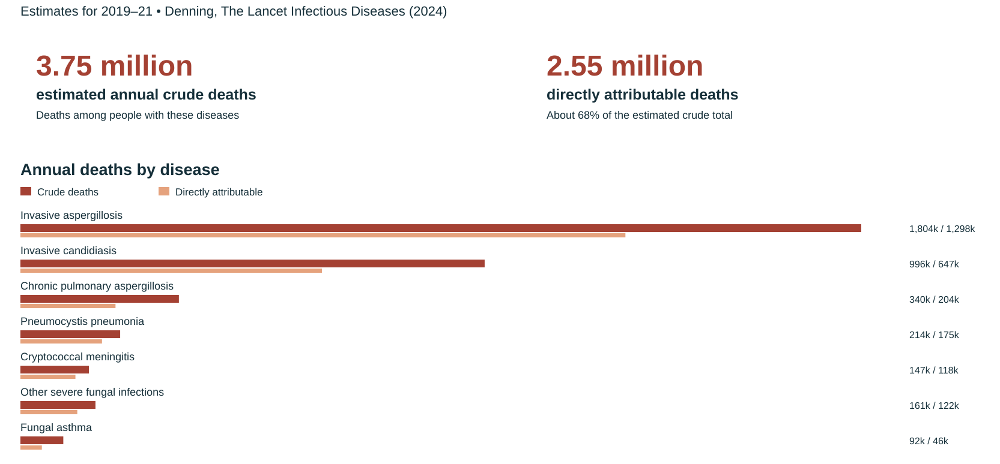
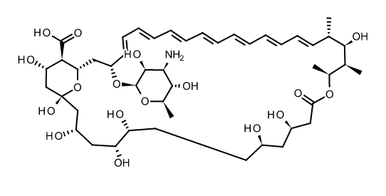
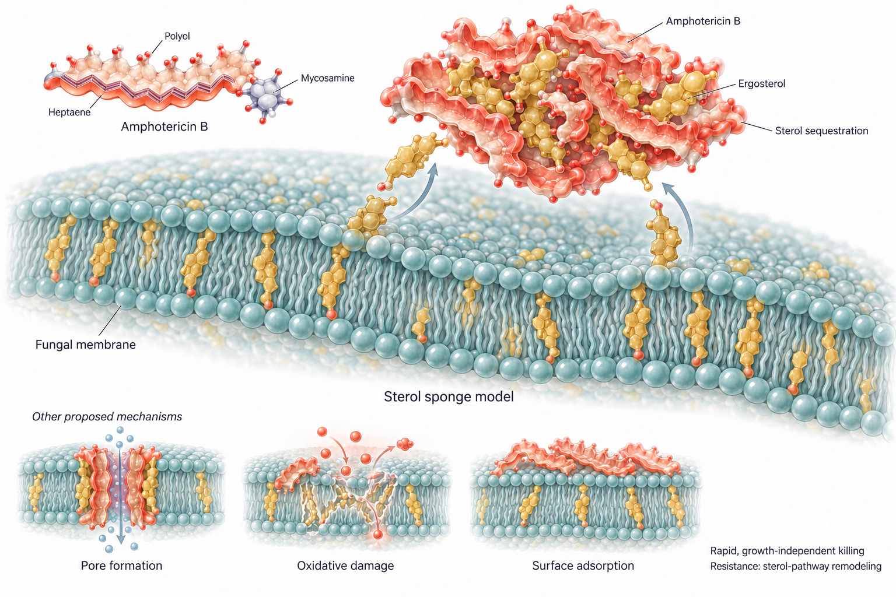
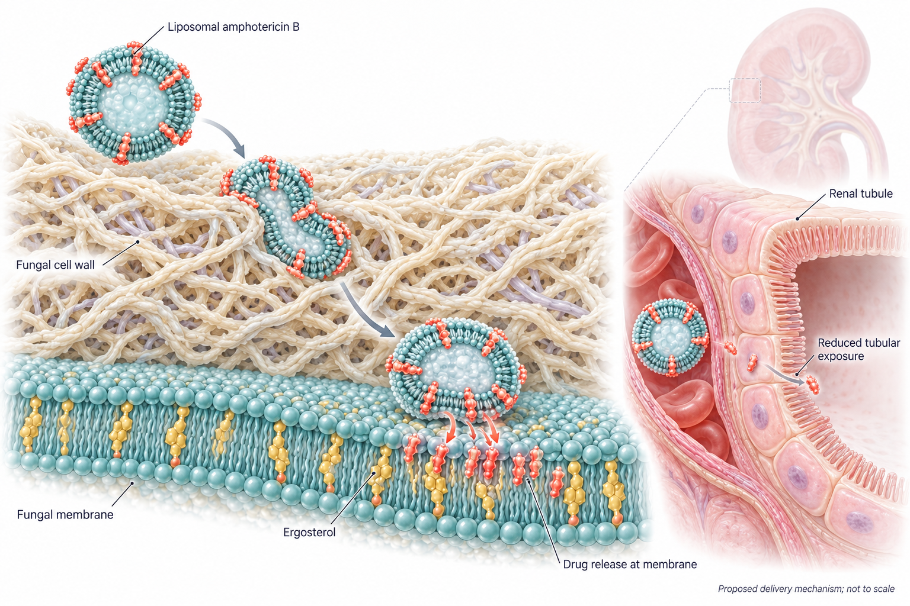
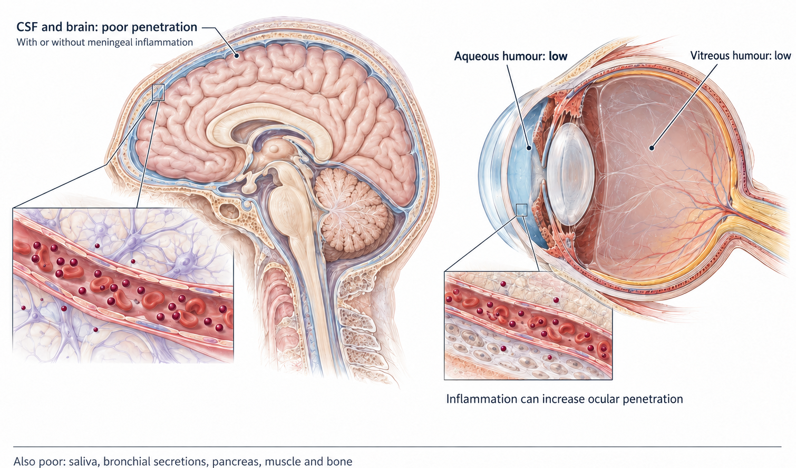
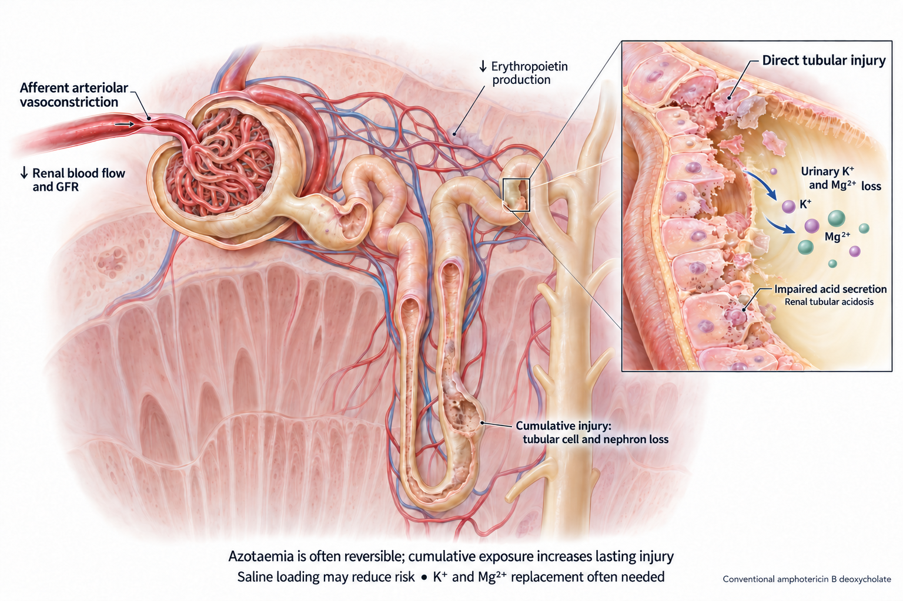
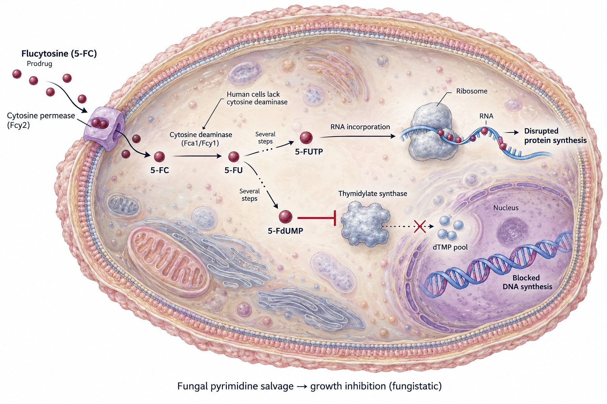
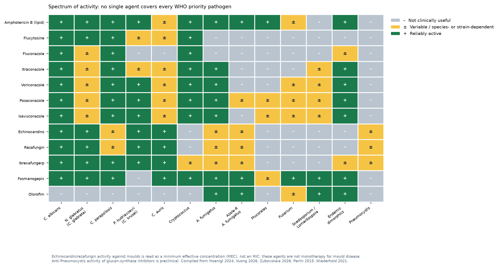
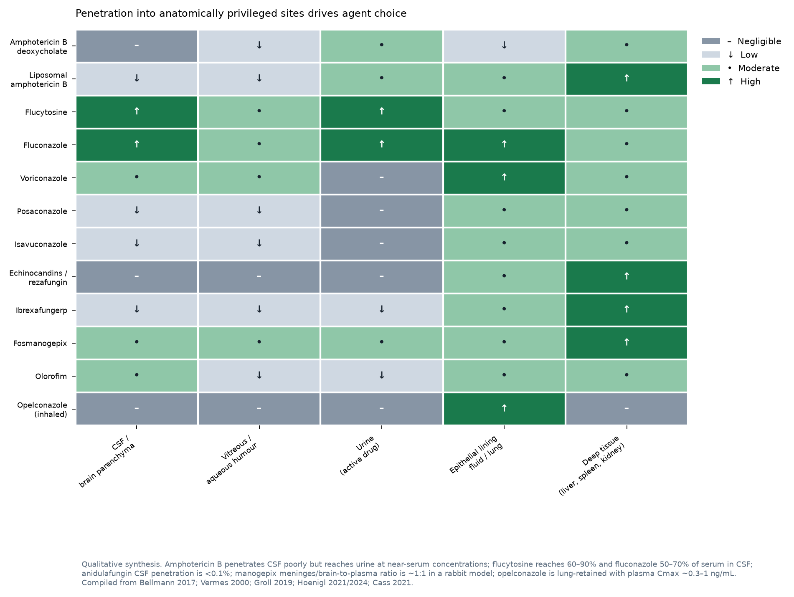

## Pharmacology of Systemic Antifungal Therapy {.light-text background-color="#b20e10"}

<br>

<center>

**Russell E. Lewis, Pharm.D., FCCP** <br> Associate Professor of
Infectious Diseases <br> Department of Molecular Medicine, University of
Padua <br>

{fig-align="center" width="350"}

<br>  russelledward.lewis\@unipd.it
<br>  https://lewis-id-lab.github.io

</center>

## Scope and objectives {.smaller}

<br>

This lecture covers the **systemically administered** **antifungal
agents:** the four established classes and the investigational agents
now in late-phase development.

**By the end you should be able to:**

1.  Map each class to its molecular target and explain why the
    eukaryotic nature of fungi constrains target choice.
2.  State the spectrum of each agent in terms of **MIC/MEC
    distributions** rather than species lists alone.
3.  Predict exposure at the site of infection from ADME properties —
    including CSF, vitreous, urine and lung.
4.  Select the correct **PK/PD index** for each class and the target
    magnitude that drives efficacy.
5.  Recognise the toxicities and interactions that limit each agent, and
    know when therapeutic drug monitoring changes management.
6.  Place rezafungin, ibrexafungerp, fosmanogepix, olorofim and
    opelconazole in the current therapeutic landscape.

<br>

::: keypoint
**Organising principle.** Spectrum tells you *whether* a drug can work;
pharmacokinetics tells you *where* it can work; pharmacodynamics tells
you *how much* you need. All three must hold for a patient to be cured.
:::

# Part 1 · The clinical problem {.section-title background-color="#b20e10"}

## The high mortality burden of fungal diseases

{fig-align="center"
width="1000"}

::: aside
[@denning2024]
:::

## WHO fungal priority pathogens list (2022)

<br>

| Priority | Pathogens | Why they are listed |
|------------------------|------------------------|------------------------|
| **Critical** | *Cryptococcus neoformans*, *Candida auris*, *Aspergillus fumigatus*, *Candida albicans* | High mortality, rising resistance, diagnostic gaps, inadequate treatment options |
| **High** | *Nakaseomyces glabratus* (*C. glabrata*), *Histoplasma* spp., eumycetoma agents, Mucorales, *Fusarium* spp., *Candida tropicalis*, *Candida parapsilosis* | Resistance, limited access to therapy, high burden in specific regions |
| **Medium** | *Scedosporium* spp., *Lomentospora prolificans*, *Coccidioides* spp., *Pichia kudriavzevii* (*C. krusei*), *Cryptococcus gattii*, *Talaromyces marneffei*, *Pneumocystis jirovecii*, *Paracoccidioides* spp. | Intrinsic multiresistance or geographically concentrated burden |

<br> <br>

::: keypoint
The list is a **research and development agenda**, not a treatment
guideline. Its practical message for pharmacology: the pathogens with
the worst outcomes are precisely those for which our existing classes
have either no activity (*L. prolificans*, *Fusarium*) or unreliable
activity (*C. auris*, azole-resistant *A. fumigatus*)
[@fisher2022threats; @gow2022importance].
:::

## Why is it difficult to develop <br> new antifungals?

<br>

::::: columns
::: {.column width="50%"}
<br> <br>

- **Target scarcity.** Fungi are eukaryotes. Pathways that are essential
  are usually conserved with the human host; selectivity must come from
  fungus-specific enzymes (Erg11, Fks1/2, Gwt1, fungal DHODH) or
  fungus-specific sterols and cell wall polymers.
- **Static versus cidal.** Only the polyenes are reliably fungicidal
  against yeasts *and* moulds; azoles are fungistatic against yeasts and
  fungicidal against moulds; echinocandins are the reverse.
- **Sanctuary sites.** CNS, eye, urine and necrotic/abscessed tissue are
  poorly served by the large, highly protein-bound molecules that
  otherwise behave well.
- **Trial design.** Mortality endpoints in heterogeneous, critically ill
  populations require large samples; the rarest and most resistant
  infections are studied in single-arm salvage trials.
:::

::: {.column width="50%"}
{fig-align="center"
width="450"}
:::
:::::

## Six decades of systemic antifungal approvals

<br>

```{=html}
<div class="tl">
<div class="tl-plot" style="height:486px">
<div class="tl-row" style="top:0px;height:27px"></div>
<div class="tl-row" style="top:54px;height:27px"></div>
<div class="tl-row" style="top:108px;height:27px"></div>
<div class="tl-row" style="top:162px;height:27px"></div>
<div class="tl-row" style="top:216px;height:27px"></div>
<div class="tl-row" style="top:270px;height:27px"></div>
<div class="tl-row" style="top:324px;height:27px"></div>
<div class="tl-row" style="top:378px;height:27px"></div>
<div class="tl-row" style="top:432px;height:27px"></div>
<div class="tl-band" style="left:59.07%;width:16.74%"></div>
<div class="tl-grid" style="left:3.33%"></div>
<div class="tl-grid" style="left:10.00%"></div>
<div class="tl-grid" style="left:16.67%"></div>
<div class="tl-grid" style="left:29.30%"></div>
<div class="tl-grid" style="left:47.91%"></div>
<div class="tl-grid" style="left:66.51%"></div>
<div class="tl-grid" style="left:85.12%"></div>
<div class="tl-break" style="left:20.00%"></div>
<div class="tl-dot tl-polyene" style="left:2.67%;top:13.5px"></div>
<div class="tl-lab tl-r tl-t-polyene" style="left:2.67%;top:13.5px"><b>Amphotericin B deoxycholate</b> <span class='tl-yr'>1959</span></div>
<div class="tl-dot tl-pyr" style="left:10.67%;top:40.5px"></div>
<div class="tl-lab tl-r tl-t-pyr" style="left:10.67%;top:40.5px"><b>Flucytosine</b> <span class='tl-yr'>1971</span></div>
<div class="tl-dot tl-azole" style="left:29.30%;top:67.5px"></div>
<div class="tl-lab tl-r tl-t-azole" style="left:29.30%;top:67.5px"><b>Fluconazole</b> <span class='tl-yr'>1990</span></div>
<div class="tl-dot tl-azole" style="left:33.02%;top:94.5px"></div>
<div class="tl-lab tl-r tl-t-azole" style="left:33.02%;top:94.5px"><b>Itraconazole</b> <span class='tl-yr'>1992</span></div>
<div class="tl-dot tl-polyene" style="left:38.60%;top:121.5px"></div>
<div class="tl-lab tl-r tl-t-polyene" style="left:38.60%;top:121.5px"><b>Amphotericin B lipid complex</b> <span class='tl-yr'>1995</span></div>
<div class="tl-dot tl-polyene" style="left:42.33%;top:148.5px"></div>
<div class="tl-lab tl-r tl-t-polyene" style="left:42.33%;top:148.5px"><b>Liposomal amphotericin B</b> <span class='tl-yr'>1997</span></div>
<div class="tl-dot tl-echino" style="left:49.77%;top:175.5px"></div>
<div class="tl-lab tl-r tl-t-echino" style="left:49.77%;top:175.5px"><b>Caspofungin</b> <span class='tl-yr'>2001</span></div>
<div class="tl-dot tl-azole" style="left:51.63%;top:202.5px"></div>
<div class="tl-lab tl-r tl-t-azole" style="left:51.63%;top:202.5px"><b>Voriconazole</b> <span class='tl-yr'>2002</span></div>
<div class="tl-dot tl-echino" style="left:57.21%;top:229.5px"></div>
<div class="tl-lab tl-r tl-t-echino" style="left:57.21%;top:229.5px"><b>Micafungin</b> <span class='tl-yr'>2005</span></div>
<div class="tl-dot tl-azole" style="left:59.07%;top:256.5px"></div>
<div class="tl-lab tl-r tl-t-azole" style="left:59.07%;top:256.5px"><b>Posaconazole</b> <span class='tl-yr'>2006</span></div>
<div class="tl-dot tl-echino" style="left:59.07%;top:283.5px"></div>
<div class="tl-lab tl-r tl-t-echino" style="left:59.07%;top:283.5px"><b>Anidulafungin</b> <span class='tl-yr'>2006</span></div>
<div class="tl-dot tl-azole" style="left:75.81%;top:310.5px"></div>
<div class="tl-lab tl-l tl-t-azole" style="left:75.81%;top:310.5px"><b>Isavuconazole</b> <span class='tl-yr'>2015</span></div>
<div class="tl-dot tl-trit" style="left:86.98%;top:337.5px"></div>
<div class="tl-lab tl-l tl-t-trit" style="left:86.98%;top:337.5px"><b>Ibrexafungerp</b> <span class='tl-yr'>2021</span></div>
<div class="tl-dot tl-tetra" style="left:88.84%;top:364.5px"></div>
<div class="tl-lab tl-l tl-t-tetra" style="left:88.84%;top:364.5px"><b>Oteseconazole</b> <span class='tl-yr'>2022</span></div>
<div class="tl-dot tl-echino" style="left:90.70%;top:391.5px"></div>
<div class="tl-lab tl-l tl-t-echino" style="left:90.70%;top:391.5px"><b>Rezafungin</b> <span class='tl-yr'>2023</span></div>
<div class="tl-dot tl-azole tl-inv" style="left:96.65%;top:418.5px"></div>
<div class="tl-lab tl-l tl-t-azole" style="left:96.65%;top:418.5px"><b>Opelconazole</b></div>
<div class="tl-dot tl-oroto tl-inv" style="left:96.65%;top:445.5px"></div>
<div class="tl-lab tl-l tl-t-oroto" style="left:96.65%;top:445.5px"><b>Olorofim</b></div>
<div class="tl-dot tl-gwt1 tl-inv" style="left:96.65%;top:472.5px"></div>
<div class="tl-lab tl-l tl-t-gwt1" style="left:96.65%;top:472.5px"><b>Fosmanogepix</b></div>
<div class="tl-note" style="left:47.91%;top:0;width:52.09%"><b>No new class for 20 years</b><br>echinocandins (2001) &rarr; ibrexafungerp (2021)</div>
<div class="tl-note tl-note2" style="left:59.07%;top:59.400000000000006px;width:16.74%">9 years, no new agent<br>(2006&ndash;2015)</div>
<div class="tl-pipe" style="left:96.4%;top:405px;width:2.8%;height:81px"></div>
<div class="tl-legend" style="left:0;top:189px">
<div><span class="tl-dot-s tl-polyene"></span>Polyene</div>
<div><span class="tl-dot-s tl-pyr"></span>Pyrimidine analogue</div>
<div><span class="tl-dot-s tl-azole"></span>Triazole / tetrazole</div>
<div><span class="tl-dot-s tl-echino"></span>Echinocandin</div>
<div><span class="tl-dot-s tl-trit"></span>Triterpenoid</div>
<div><span class="tl-dot-s tl-oroto"></span>Orotomide</div>
<div><span class="tl-dot-s tl-gwt1"></span>Gwt1 inhibitor</div>
<div><span class="tl-dot-s tl-hollow"></span>Investigational (phase 2/3)</div></div>
</div>
<div class="tl-axis">
<span style="left:3.33%">1960</span>
<span style="left:10.00%">1970</span>
<span style="left:16.67%">1980</span>
<span style="left:29.30%">1990</span>
<span style="left:47.91%">2000</span>
<span style="left:66.51%">2010</span>
<span style="left:85.12%">2020</span>
<span class="tl-axisinv" style="left:96.65%">pipeline</span>
</div></div>
```

::: source
Year of first US approval. Ibrexafungerp (2021), oteseconazole (2022)
and rezafungin (2023) ended a long drought; fosmanogepix, olorofim and
opelconazole are in phase 2/3 [@hoenigl2021pipeline; @hoenigl2024novel].
:::

## Four established targets, three new ones {.smaller}

<br>

| Target | Molecular site | Agents | Effect on the cell |
|------------------|------------------|------------------|------------------|
| **Ergosterol itself** | Membrane ergosterol — extraction into an extramembranous "sterol sponge" | Amphotericin B (deoxycholate, ABLC, liposomal) | Sterol depletion, permeability loss, oxidative injury; **fungicidal** [@gray2012ampbsterol; @anderson2014spongeamb] |
| **Ergosterol synthesis** | Lanosterol 14α-demethylase (Erg11 / Cyp51A) | Triazoles, tetrazole (oteseconazole), inhaled opelconazole | Ergosterol depletion plus accumulation of toxic 14α-methyl sterols; **fungistatic** vs yeasts, fungicidal vs moulds |
| **Cell wall β-1,3-glucan** | β-1,3-D-glucan synthase (Fks1 / Fks2) | Echinocandins, rezafungin; triterpenoid ibrexafungerp at a distinct site | Loss of wall integrity and lysis; **fungicidal** vs *Candida*, fungistatic vs *Aspergillus* |
| **Pyrimidine salvage** | Cytosine deaminase (Fca1) → 5-FU → RNA miscoding and thymidylate synthase inhibition | Flucytosine | **Fungistatic**; requires partner drug |
| **GPI-anchor maturation** | Gwt1 inositol acyltransferase | Fosmanogepix (prodrug of manogepix) | Mannoproteins fail to anchor to the wall; loss of adhesion, biofilm and germ-tube formation |
| **Pyrimidine *de novo* synthesis** | Fungal dihydroorotate dehydrogenase (DHODH) | Olorofim (orotomide) | Pyrimidine starvation; **fungicidal** vs moulds, no yeast activity [@oliver2016f901318] |
| **Iron uptake** | Sit1 siderophore transporter | ATI-2307, VL-2397 class | Fungus-specific transporter-mediated entry |

::: keypoint
Fungi are eukaryotes: every one of these targets exists because it is
**absent or structurally divergent in humans**.
:::

## The pharmacodynamic framework

<br>

| Class | PK/PD index | Driver of effect | Implication for dosing |
|------------------|------------------|------------------|------------------|
| Polyenes | **C~max~/MIC, AUC/MIC** | Concentration-dependent killing, long post-antifungal effect | Large intermittent doses; single 10 mg/kg liposomal dose is rational |
| Triazoles | **AUC~0–24~/MIC** | Exposure-dependent, saturable | Total daily exposure matters, not peak; loading doses needed |
| Echinocandins | **C~max~/MIC, AUC/MIC,** <br> (MEC for moulds) | Concentration-dependent with prolonged persistence in tissue | Front-loading works; weekly rezafungin exploits this |
| Flucytosine | **%T \> MIC** | Time-dependent, fungistatic | Divided dosing; never monotherapy |
| Olorofim | **AUC/MIC** (MEC) | Exposure-dependent | Twice-daily oral dosing to a minimum concentration target |

<br> <br>

::: important
**Why the index matters.** The AUC/MIC ratio predicted efficacy across
*Candida*, *Cryptococcus* and *Aspergillus* models for the azoles,
whereas amphotericin B killing is best described by the ratio of peak
concentration to MIC [@andes2001pd]. Echinocandin targets differ by
species — the free-drug AUC/MIC needed for stasis is substantially
higher for *C. parapsilosis* than for *C. albicans*
[@andes2010echinopd].
:::

<br>

::: caution
MIC is not interchangeable across methods. EUCAST and CLSI values
diverge for several agents; rezafungin required 0.002% Tween 20 in the
medium to stop non-specific binding to plastics from inflating MICs
(Hoenigl et al., 2024). Against moulds, echinocandins and manogepix are
read as a minimum effective concentration (MEC) — the lowest
concentration producing short, stubby, aberrantly branched hyphae — not
an MIC.
:::

# Part 2 · Established agents {.section-title background-color="#b20e10"}

## Polyenes · amphotericin B

{fig-align="center"}

::: {}
Amphotericin B is an amphipathic heptaene macrolide: a lactone ring with
seven conjugated double bonds (lipophilic face) opposite a polyol face
(hydrophilic), plus a mycosamine sugar. It is zwitterionic and poorly
water-soluble, hence the deoxycholate or lipid carriers.
:::

## Polyenes · mechanism of action

{fig-align="center"
width="650"}

::: keypoint
**One drug, four formulations.** The active moiety is identical;
formulation changes distribution and toxicity, **never spectrum**:

- amphotericin B deoxycholate (AMBD, 1959)
- amphotericin B colloidal dispersion (ABCD)-no longer available
- amphotericin B lipid complex (ABLC)
- liposomal amphotericin B (L-AmB)
:::

## How does the liposomal formulation <br> change the pharmacology of amphotericin B?

<br>

{fig-align="center"
width="650"}

::: {}
Liposomal amphotericin B traverses the fungal cell wall and releases
amphotericin B at the ergosterol-containing cell membrane, disrupting
membrane function. Liposomal encapsulation limits renal tubular exposure
to amphotericin B, reducing nephrotoxicity compared with the
conventional deoxycholate formulation.
:::

## Polyenes · microbiology and spectrum

<br>

| Organism | Typical MIC~90~ (mg/L) | Comment |
|------------------------|------------------------|------------------------|
| *C. albicans*, *C. tropicalis*, *C. parapsilosis* | 0.25–1 | Wild-type; EUCAST/CLSI susceptible ≤1 |
| *N. glabratus* (*C. glabrata*) | 0.5–1 | Reliably active; MICs slightly higher than *C. albicans* |
| *C. auris* | 1–\>2 | **Amphotericin B resistance in \~30–40% of isolates** |
| *C. lusitaniae* | variable, often \>1 | Classic intrinsic/inducible resistance |
| *Cryptococcus neoformans* | 0.25–1 | Backbone of induction therapy |
| *A. fumigatus* | 0.5–2 | Active; *A. terreus*, *A. lentulus*, *A. calidoustus* intrinsically resistant |
| Mucorales | 0.25–1 | Drug of choice for first-line therapy |
| *Fusarium* spp. | 1–\>8 | Variable; *F. solani* complex least susceptible |
| *Scedosporium* / *L. prolificans* | \>8 | Intrinsically resistant |

<br> <br>

::: pearl
**Where amphotericin B fails *in vitro*.** Primary resistance clusters
in *A. terreus*, *A. calidoustus*, *A. lentulus*, *Scedosporium*,
*Trichosporon*, and — among yeasts — *C. lusitaniae* and *C. auris*.
Acquired resistance in normally susceptible species is rare and usually
accompanied by reduced growth and virulence, reflecting the cost of
rebuilding the sterol pathway (*ERG2*, *ERG3* lesions, alternative
sterols, sphingolipid modulation).
:::

## Polyenes · ADME

<br>

| Parameter | Amphotericin B deoxycholate | Liposomal amphotericin B |
|------------------------|------------------------|------------------------|
| **Absorption** | Not orally bioavailable; IV only | IV only (oral encochleated formulation investigational) |
| **Protein binding** | \>95%, principally to β-lipoprotein | High; drug remains liposome-associated in circulation |
| **C~max~** | 0.5–2.0 mg/L at conventional doses, falling to a 0.2–0.5 mg/L plateau | Markedly higher C~max~ and AUC at equal mg/kg — up to \~10-fold [@groll2019lamb] |
| **Distribution** | Leaves plasma rapidly, binds cholesterol-containing membranes; stored in liver and other organs; localises to endothelium, including activated endothelium at infection sites | Preferential uptake by the reticuloendothelial system; high liver/spleen concentrations |
| **Metabolism / elimination** | Degraded *in situ*; only a small fraction excreted in urine or bile | Similar; negligible renal clearance of active drug |
| **Half-life** | Initial \~24 h; terminal β-phase \~15 days; detectable in serum up to 7 weeks after the last dose | Prolonged; supports intermittent high-dose strategies |
| **Organ dysfunction** | Blood levels **unaffected** by renal or hepatic failure; **not removed by haemodialysis** | No dose adjustment for renal replacement therapy |

<br> <br>

::: source
Formulation pharmacokinetics compiled from refs [@bellmann2017ampk;
@hamill2013lamb; @groll2019lamb].
:::

## Polyenes · penetration into privileged sites

{fig-align="center" width="800"}

::: callout-note
**The cryptococcal paradox.** Amphotericin B achieves minimal CSF
concentrations yet produces the fastest rate of CSF sterilisation of any
agent. Explanations include cidal activity against organisms in the
subarachnoid space at low concentrations, high meningeal and
choroid-plexus tissue binding, and the long tissue residence of drug. In
animal models, liposomal amphotericin B has superior CNS penetration vs.
conventional AMB. The practical lesson: **plasma or CSF concentration is
a poor surrogate for polyene effect.**
:::

## Polyenes · pharmacodynamics

<br>

- **Concentration-dependent killing.** Time–kill and murine models show
  that effect is best described by **C~max~/MIC**; onset is rapid and
  unrelated to growth rate [@andes2001pd].
- **Prolonged post-antifungal effect**, consistent with drug remaining
  bound to membrane sterols after free concentrations fall.
- Together these properties justify **large, infrequent dosing** of the
  liposomal formulation.

<br>

<br>

::: keypoint
**Clinical proof of the PD logic.** In AMBITION-cm, a **single 10
mg/kg** dose of liposomal amphotericin B plus 14 days of flucytosine and
fluconazole was non-inferior to 7 days of daily amphotericin B
deoxycholate for HIV-associated cryptococcal meningitis, with **less
toxicity** [@jarvis2022ambition].
:::

::: caution
**More is not always better.** In AmBiLoad, liposomal amphotericin B 10
mg/kg/day for invasive mould disease produced no efficacy benefit over 3
mg/kg/day but more nephrotoxicity and hypokalaemia
[@cornely2007ambiload]. Front-loading works for a single sterilising
dose, not as a chronic daily strategy.
:::

## Polyene toxicity · Dose-limiting nephrotoxicity

{fig-align="center" width="800"}

## Polyene · infusion-related reactions

<br>

::::: columns
::: {.column width="50%"}
### Direct (cytokine) reaction

*Classically with amphotericin B deoxycholate*

- **Mechanism:** deoxycholate-AMB stimulates innate immune cells via
  TLR/CD14 signalling (mainly TLR2/TLR1; TLR4 contribution reported),
  releasing TNF-α, IL-1β, IL-6 and IL-8 [@sau2003amb;
  @razonable2005tlr1].
- **Onset:** chills, fever and tachypnoea **30–45 min** into the first
  infusions; peak at 15–30 min; settle over 2–4 h.
- **Course:** milder with successive doses; less common in young
  children and in patients on corticosteroids.
- **Mitigation:** paracetamol premedication, hydrocortisone 25–50 mg in
  the infusion, meperidine for established rigors.
:::

::: {.column width="50%"}
### CARPA

*Complement activation-related pseudoallergy, seen with liposomal AMB*

- **Mechanism:** liposomes activate complement; the anaphylatoxins C3a
  and C5a trigger mast cell and basophil degranulation
  [@szebeni2005carpa]. Not IgE-mediated, so no prior sensitisation is
  needed [@thompson2025carpa].
- **Onset:** within **minutes** of starting the infusion; C3a and SC5b-9
  are already raised at 5 min [@thompson2025carpa].
- **Features:** chest and back pain, flushing, dyspnoea, haemodynamic
  change, sometimes fever [@thompson2025carpa; @roden2003triad].
- **Management:** pause or stop the infusion, give antihistamine ±
  steroid, and consider restarting more slowly; premedication and rate
  reduction are practical, but controlled evidence is limited
  [@nham2025infusion; @thompson2025carpa].
:::
:::::

::: keypoint
**Different mechanism, different fix.** Antipyretic and steroid
premedication targets the cytokine reaction; CARPA is complement-driven,
so management centres on pausing or slowing the infusion and treating
symptoms.
:::

## Polyenes · other adverse effects

<br>

- Normocytic normochromic anaemia (haematocrit rarely \<20–25%), nausea,
  anorexia, phlebitis.
- Rare: thrombocytopenia, arrhythmia, hepatic transaminase elevation,
  encephalopathy, seizures.
- **Lipid formulations reduce but do not abolish** nephrotoxicity and
  infusion reactions.
- **Virtually no CYP-mediated drug interactions** — but additive
  nephrotoxicity with calcineurin inhibitors and aminoglycosides.

<br> <br>

::: keypoint
**TDM has no established role.** Routine measurement of serum, urine or
CSF amphotericin B concentrations does not aid management; monitoring is
of renal function, potassium and magnesium.
:::

## Polyenes · clinical use

<br>

| Indication | Role |
|------------------------------------|------------------------------------|
| **Mucormycosis** | First-line therapy, liposomal formulation, high dose [@cornely2019mucormycosis] |
| **Cryptococcal meningitis** | Induction backbone with flucytosine; single-dose 10 mg/kg L-AmB regimen in resource-limited settings [@jarvis2022ambition; @molloy2018acta] |
| **Invasive candidiasis** | Alternative to echinocandins; preferred where CNS, ocular or urinary involvement is suspected [@pappas2016idsacandida] |
| **Invasive aspergillosis** | Second-line, or first-line when azole resistance is likely or azoles cannot be used [@patterson2016idsaaspergillosis; @ullmann2018escmidaspergillosis] |
| **Endemic mycoses** | Severe/disseminated disease induction, followed by oral triazole step-down |
| **Empirical therapy in persistent neutropenic fever** | Historical standard; largely replaced by pre-emptive, diagnostic-driven strategies |

<br> <br>

::: pearl
Choose the **lipid formulation** for essentially all systemic
indications in high-income settings. Deoxycholate retains a role where
cost dominates and renal monitoring is feasible — and the single-dose
liposomal regimen now offers a toxicity-sparing alternative in exactly
those settings [@jarvis2022ambition].
:::

## Flucytosine · mechanism of action

{fig-align="center" width="650"}

::: caution
**Resistance is easy and fast — never use alone.**

- *FUR1* C301T → R101C in uracil phosphoribosyltransferase (impaired
  quaternary structure)
- Homozygous *FCA1* G28D in cytosine deaminase
- In *Cryptococcus*: *MBS1*, *UXS1* and *URA6* lesions beyond the
  salvage pathway
- In *A. fumigatus*: pH-dependent resistance — the CBC and PacC
  regulators downregulate the purine–cytosine permease orthologue *fcyB*
:::

## Flucytosine · microbiology and spectrum

<br>

| Organism | Typical MIC~90~ (mg/L) | Clinical relevance |
|------------------------|------------------------|------------------------|
| *C. albicans* | 0.12–0.5 | Highly susceptible; wild-type |
| *N. glabratus* (*C. glabrata*) | 0.12–0.5 | Susceptible |
| *C. tropicalis*, *C. parapsilosis* | 0.12–1 | Susceptible |
| *P. kudriavzevii* (*C. krusei*) | 1–32 | Reduced susceptibility |
| *Cryptococcus neoformans* / *gattii* | 2–8 | **Key indication** — synergy with amphotericin B |
| *Aspergillus* spp. | \>32 (pH-dependent) | Not clinically useful |
| Mucorales, *Fusarium*, *Scedosporium* | \>64 | No activity |

<br> <br>

::: pearl
Spectrum is essentially **yeasts only**, and the indication is driven by
**synergy** rather than by potency: amphotericin B permeabilises the
membrane and increases flucytosine entry, while flucytosine accelerates
sterilisation of the CSF.
:::

## Flucytosine · ADME

<br>

| Parameter | Value |
|------------------------------------|------------------------------------|
| **Oral bioavailability** | Excellent: **78–89%** absorbed in healthy volunteers; peak **30–40 mg/L within 2 h** of a 2 g dose |
| **Effect of food / antacids** | Absorption **delayed** (not reduced) by food or aluminium hydroxide |
| **Bioavailability in disease** | Falls to **40–76%** in renal failure and \~**45%** in late-stage HIV infection |
| **Volume of distribution** | \~**0.6 L/kg** — approximates total body water, independent of renal function |
| **Protein binding** | **\<4%** — effectively unbound drug |
| **Metabolism** | No conventional hepatic metabolism. About **4%** of an oral dose is deaminated to 5-FU by **intestinal bacterial flora** — enough to reach 5-FU exposures associated with cytotoxicity |
| **Elimination** | **Renal, unchanged**, by glomerular filtration with little tubular handling; **up to 95% recovered in urine within 24 h** |
| **Dialysis** | Clearance by haemodialysis is **nearly indistinguishable from creatinine clearance** — dose after dialysis |

::: source
Parameters as tabulated in the primary chapter source and the standard
pharmacology review [@vermes2000flucytosine].
:::

<br> <br>

::: keypoint
**Renal function is the entire dosing story.** A small, hydrophilic,
unbound, renally cleared drug with a narrow therapeutic index: every
dose must be adjusted to creatinine clearance, and concentrations must
be measured.
:::

## Flucytosine · penetration and pharmacodynamics

<br>

::::: columns
::: {.column width="52%"}
**Penetration — the best of any antifungal**

- **CSF: 60–90% of the simultaneous serum concentration.**
- Peritoneal fluid: 5% to nearly 50% of serum, increasing with
  inflammation.
- Also penetrates bronchial secretions and articular fluid well.
- **Urine: up to 95% of the dose appears as active drug** — Effective
  for *Candida* cystitis and renal parenchymal disease.
:::

::: {.column width="48%"}
**Pharmacodynamics**

- **Fungistatic** in time–kill and murine models.
- Substantial **post-antifungal effect**: 2–4 h *in vitro*, 3.3–15.1 h
  *in vivo*; the effect increases with concentrations up to \~4× MIC.
- The index that best predicts efficacy is **%T \> MIC**, supporting
  conventional divided dosing (100 mg/kg/day in four divided doses).
:::
:::::

<br> <br>

::: pearl
A time-dependent, fungistatic agent with near-complete oral absorption,
free drug distribution into every compartment of interest, and renal
elimination — pharmacologically close to ideal, and limited almost
entirely by **toxicity and resistance**, not by exposure.
:::

## Flucytosine · toxicity and therapeutic drug monitoring

<br>

:::::: columns
::: {.column width="52%"}
**Toxicity is largely 5-FU toxicity**

- **Dose-related myelosuppression** — neutropenia and thrombocytopenia;
  the principal risk, and the reason for monitoring.
- **Hepatotoxicity**: transaminase elevation, usually reversible.
- **Gastrointestinal**: nausea, vomiting, diarrhoea; severe
  enterocolitis is described.
- Risk rises steeply with **accumulation in renal impairment** and with
  intestinal conversion to 5-FU.
:::

:::: {.column width="48%"}
**TDM is mandatory, not optional**

|   | Target |
|------------------------------------|------------------------------------|
| Peak (2 h post-dose) | **30–80 mg/L** |
| Concentration to avoid | **\>100 mg/L** — strongly associated with marrow and hepatic toxicity |
| Sampling | At steady state (\~day 3–4) and after every dose change or change in renal function |

::: caution
Fifteen years of UK monitoring experience confirm that a substantial
proportion of patients fall outside the target range on standard
weight-based dosing, chiefly because of unrecognised renal impairment
[@pasqualotto2007flucytosinetdm; @ashbee2014tdmguideline].
:::
::::
::::::

## Flucytosine · clinical use

<br>

| Indication | Regimen and evidence |
|------------------------------------|------------------------------------|
| **Cryptococcal meningitis — induction** | With amphotericin B. In the ACTA trial, **one week** of amphotericin B deoxycholate plus flucytosine was as effective as two weeks and less toxic; oral fluconazole plus flucytosine was an effective all-oral alternative where amphotericin B is unavailable [@molloy2018acta] |
|  | Adding flucytosine to amphotericin B improves the rate of CSF sterilisation and survival compared with amphotericin B alone [@day2013combination] |
|  | Now also the partner for **single-dose 10 mg/kg liposomal amphotericin B** [@jarvis2022ambition] |
| **Candida CNS infection, endophthalmitis** | Added to amphotericin B for sanctuary-site penetration [@pappas2016idsacandida] |
| **Candida urinary tract infection** | Option for fluconazole-resistant *Candida* cystitis — short courses only, because resistance emerges rapidly |
| **Chromoblastomycosis, selected rare moulds** | Adjunctive, historical |

::: keypoint
**Access, not evidence, is the limiting factor.** Flucytosine is
unavailable or unaffordable in much of the region carrying the greatest
cryptococcal burden — a major contributor to global cryptococcal
mortality [@denning2024burden; @molloy2018acta].
:::

## Azoles · mechanism of action

<br>

::::::: columns
::: {.column width="55%"}
- Azoles bind the haem iron of **lanosterol 14α-demethylase
  (Cyp51/Erg11)**, blocking conversion of lanosterol to ergosterol.
- Two consequences, not one: **ergosterol depletion** *and*
  **accumulation of toxic 14α-methylated sterols** that destabilise the
  membrane.
- Potency and spectrum across the class track **affinity for the
  demethylase**; toxicity and interactions track **cross-inhibition of
  human CYP3A4, CYP2C9 and CYP2C19**.
- Ring nitrogen count defines the subclass:
  - **imidazoles** (2 N) — ketoconazole, miconazole, clotrimazole: now
    topical only
  - **triazoles** (3 N) — fluconazole, itraconazole, voriconazole,
    posaconazole, isavuconazole
  - **tetrazole** (4 N) — oteseconazole: engineered for fungal Cyp51
    selectivity
- Azoles have **no antibacterial activity**, unlike the nitroimidazoles.
:::

::::: {.column width="45%"}
::: keypoint
**Fungistatic against yeasts, fungicidal against moulds.** This
asymmetry explains why azoles work as step-down and prophylaxis in
candidiasis, but can be curative monotherapy in aspergillosis.
:::

::: pearl
The tetrazole scaffold of **oteseconazole** replaces the triazole
iron-binding group to gain selectivity for fungal Cyp51 over human CYP
enzymes — fewer interactions, fewer off-target effects.
:::
:::::
:::::::

## Triazoles · comparative spectrum and MICs {.smaller}

<br>

| Organism | Fluconazole | Itraconazole | Voriconazole | Posaconazole | Isavuconazole |
|------------|------------|------------|------------|------------|------------|
| *C. albicans* (MIC~90~, mg/L) | 0.25–1 | 0.06–0.25 | 0.015–0.06 | 0.03–0.06 | 0.015–0.06 |
| *N. glabratus* (*C. glabrata*) | 8–32 | 0.5–2 | 0.25–1 | 0.5–2 | 0.5–2 |
| *C. parapsilosis* | 0.5–2 | 0.12–0.5 | 0.03–0.12 | 0.06–0.25 | 0.03–0.12 |
| *P. kudriavzevii* (*C. krusei*) | 32–64 (**intrinsic R**) | 0.25–1 | 0.12–0.5 | 0.12–0.5 | 0.12–0.5 |
| *C. auris* | 32–\>64 (**\~90% R**) | variable | 0.5–\>8 | 0.06–1 | 0.12–1 |
| *Cryptococcus neoformans* | 2–8 | 0.12–0.5 | 0.03–0.12 | 0.06–0.25 | 0.03–0.12 |
| *A. fumigatus* (MEC/MIC) | \>64 (**no activity**) | 0.5–1 | 0.5–1 | 0.03–0.25 | 0.5–2 |
| Mucorales | \>64 | \>8 | **\>8 (intrinsic R)** | 0.5–2 | 1–4 |
| *Fusarium* spp. | \>64 | \>8 | 2–\>8 | 2–\>8 | 4–\>8 |
| *L. prolificans* | \>64 | \>8 | \>8 | \>8 | \>8 |

::: source
Representative wild-type MIC~90~ ranges compiled from surveillance data
summarised in refs [@hoenigl2024novel; @perlin2015fks;
@verweij2016azoleres]. Use local EUCAST/CLSI breakpoints for
interpretation — method, medium and endpoint all shift the number.
:::

::: caution
**Three intrinsic resistances to memorise:** fluconazole has no mould
activity; voriconazole has no Mucorales activity (a distinctive Cyp51
sequence); *L. prolificans* is resistant to every licensed agent.
:::

## Triazoles · resistance mechanisms

<br>

::::: columns
::: {.column width="50%"}
**In *Candida***

- Overexpression of **ERG11** plus efflux via **MDR1, CDR1, CDR2** — the
  dominant mechanism in *C. albicans*; point substitutions are less
  common.
- *N. glabratus*: efflux (**Cdr1, Cdr2**); resistance can sometimes be
  overcome by higher exposure, but an alternative class is recommended
  for invasive disease. A **mismatch-repair "mutator" phenotype**
  facilitates multiclass resistance.
- *P. kudriavzevii*: **intrinsic** fluconazole resistance from *ERG11*
  sequence.
- *C. parapsilosis*: emerging fluconazole resistance, mostly **Y132F in
  Erg11**.
- *C. auris*: largely fluconazole-resistant via *ERG11* mutations,
  variable for other azoles.
- Cross-resistance with amphotericin B occurs via **ERG2/ERG3** lesions.
:::

::: {.column width="50%"}
**In *Cryptococcus***

- Mostly **heteroresistance**: unstable, transient adaptation from
  **duplication of chromosome 1**, which carries *ERG11* and the efflux
  pump *AFR1* — not classical point mutation.
- Up to 12% of isolates show reduced fluconazole susceptibility; MICs
  rose between 2007 and 2017.

**In *Aspergillus fumigatus***

- **Point mutations in *CYP51A*** — pattern determines which azoles are
  lost.
- **Environmental, fungicide-driven resistance**: a 34-bp tandem repeat
  in the *cyp51A* promoter with L98H (**TR~34~/L98H**) gives pan-azole
  resistance; **TR~46~/Y121F/T289A** gives high-level voriconazole
  resistance [@snelders2008tr34; @verweij2016azoleres].
- Non-*cyp51A* mechanisms and cryptic species (*A. lentulus*, *A.
  tubingensis*, *A. calidoustus*) add further resistance — **always
  identify to species and test**.
:::
:::::

## Triazoles · comparative ADME {.smaller}

<br>

::: smaller-table
| Parameter | Fluconazole | Itraconazole | Voriconazole | Posaconazole (DR tablet / IV) | Isavuconazole |
|------------|------------|------------|------------|------------|------------|
| **Oral bioavailability** | \>90%; \>90% of an oral dose appears in the circulation | Erratic; capsules need acid **and** food; solution better fasting; SUBA formulation improves it | \~96% | Suspension low and saturable; **delayed-release tablet high and reliable** | \~98% |
| **Food / gastric pH** | **No effect** | Major effect | Reduced by food; take 1 h apart from meals | Suspension needs food and acid; **tablet and IV unaffected** | No effect |
| **Protein binding** | \~**10%** | 99.8% | \~58% | \>98% | \>99% |
| **Half-life** | \~**30 h** | 21–64 h (saturable) | \~6 h, **non-linear** | 25–31 h | \~**130 h** |
| **Metabolism** | Minimal — **80% excreted unchanged in urine** | CYP3A4 → active hydroxy-itraconazole | **CYP2C19** (polymorphic), CYP2C9, CYP3A4 | **UGT1A4 glucuronidation**, P-gp substrate | CYP3A4/3A5 and UGT |
| **Kinetics** | Linear, highly predictable | Non-linear, **least predictable** with voriconazole | Non-linear, **least predictable** | Intermediate predictability | Linear, intermediate–good predictability |
| **Renal adjustment** | **Yes** — 50% if CrCl \<50 mL/min, 25% if \<20 mL/min; full dose after each dialysis session | No | Oral no; **IV vehicle (SBECD) accumulates** in renal impairment | No | No |
| **Prodrug** | — | — | — | — | **Isavuconazonium sulfate**, cleaved by plasma esterases |
:::

::: source
Compiled from refs [@bellmann2017ampk; @bruggemann2009interactions;
@jenks2020isavu]; fluconazole parameters and renal dose adjustments as
per the primary chapter source.
:::

## Triazoles · penetration into privileged sites

<br>

| Site | Fluconazole | Voriconazole | Posaconazole | Isavuconazole | Itraconazole |
|------------|------------|------------|------------|------------|------------|
| **CSF** | **50–70% of serum** | \~50% of plasma; good brain parenchymal concentrations | Low in CSF, better in brain tissue | Low in CSF, measurable brain tissue | Negligible |
| **Vitreous / aqueous** | Good | Good — agent of choice for fungal endophthalmitis with susceptible organisms | Low | Low | Negligible |
| **Urine (active drug)** | **High — 80% unchanged**; the only triazole reliably active in urine | \<2% unchanged | Minimal | Minimal | Minimal |
| **Epithelial lining fluid / lung** | Good | High | Good; high alveolar macrophage concentrations | Good | Moderate |
| **Saliva / mucosa** | Excellent | Good | Good | Good | Moderate |

::: keypoint
**Two site-specific rules.** For *Candida* urinary tract disease,
fluconazole (or flucytosine, or amphotericin B) — **not** an
echinocandin, posaconazole or isavuconazole. For CNS or ocular
candidiasis or aspergillosis, fluconazole or voriconazole have the
distribution; posaconazole and isavuconazole have brain tissue
penetration but low CSF concentrations.
:::

## Triazoles · pharmacodynamics and TDM targets

<br>

::::: columns
::: {.column width="48%"}
- The index is **AUC~0–24~/MIC**, validated across *Candida*,
  *Cryptococcus* and *Aspergillus* models [@andes2001pd].
- Because exposure is the driver, **loading doses** are needed for every
  agent with a long half-life, and trough concentration is used as a
  practical surrogate for AUC.
- TDM is indicated where exposure is unpredictable — which, for this
  class, means **most agents most of the time**.
:::

::: {.column width="52%"}
| Agent | Trough target | When to measure |
|------------------------|------------------------|------------------------|
| **Fluconazole** | Not routinely defined | High-dose coccidioidomycosis, renal dysfunction, morbid obesity |
| **Itraconazole** | **\>0.5–1 mg/L** (itraconazole; some add hydroxy-metabolite) | All patients — absorption is erratic |
| **Voriconazole** | **1–5.5 mg/L**: \>1–2 for efficacy, **\<5.5 to avoid neurotoxicity** | All patients, day 4–7, after any dose change |
| **Posaconazole** | **≥0.7 mg/L** prophylaxis; **≥1.0–1.25 mg/L** treatment | Suspension always; tablet/IV if absorption or response in doubt |
| **Isavuconazole** | Not routinely required | Obesity, ECMO, poor response, significant interactions |
:::
:::::

::: keypoint
**Voriconazole TDM changes outcomes.** Observational and randomised data
show that dose adjustment to a target trough **increases response and
reduces drug discontinuation for toxicity** [@pascual2008voritdm;
@park2012voritdm; @troke2011voriqtc; @ashbee2014tdmguideline;
@johnson2018tdm].
:::

## Triazoles · drug interactions {.smaller}

<br>

:::::: columns
::: {.column width="54%"}
**Mechanism.** All triazoles inhibit **CYP3A4**; fluconazole and
voriconazole additionally inhibit **CYP2C9** and **CYP2C19**.
Itraconazole has the largest interaction burden; fluconazole and
isavuconazole the smallest [@bruggemann2009interactions].

**Azole concentration *raised* by other drugs**: clarithromycin,
erythromycin, indinavir, ritonavir (itraconazole).

**Azole concentration *reduced* by other drugs** — usually an absolute
contraindication: rifampicin, rifabutin, phenobarbital, phenytoin,
carbamazepine, long-acting barbiturates, St John's wort, efavirenz.
Antacids, H~2~-blockers and PPIs reduce itraconazole capsules and
posaconazole **suspension** (not the tablet).
:::

:::: {.column width="46%"}
**Clinically critical substrate interactions**

| Substrate | Consequence |
|------------------------------------|------------------------------------|
| Tacrolimus, ciclosporin, sirolimus | Large exposure increases; pre-emptive dose reduction and TDM. Voriconazole's effect on tacrolimus is **greater with oral than IV** administration |
| Venetoclax, ibrutinib, midostaurin, ruxolitinib, glasdegib | Major exposure increases; dose reduction per label |
| Vinca alkaloids | Neurotoxicity — **avoid** |
| Statins (CYP3A4-dependent) | Myopathy risk |
| QT-prolonging agents (pimozide, quinidine, dofetilide, terfenadine, cisapride) | **Contraindicated** |
| Warfarin | INR rise, especially fluconazole and voriconazole (CYP2C9) |

::: caution
**Isavuconazole shortens the QT interval** — the opposite of the class
effect — and is contraindicated in familial short QT syndrome.
:::
::::
::::::

## Triazoles · adverse effects by agent

<br>

| Agent | Characteristic toxicities |
|------------------------------------|------------------------------------|
| **Fluconazole** | Generally benign: headache, alopecia, xerosis, cheilitis — all reversible. Hepatotoxicity and QTc prolongation possible with any triazole. Neurotoxicity reported at very high doses (2000 mg/day). **Teratogen — FDA category D**; high-dose first-trimester exposure linked to skeletal and cardiac defects |
| **Itraconazole** | Negative inotropy — **contraindicated in heart failure**; oedema, hypertension, hypokalaemia; GI intolerance with the oral solution |
| **Voriconazole** | **Transient visual disturbance** (\~30%; reversible dysfunction of retinal ON-bipolar cells); hepatotoxicity; **encephalopathy and hallucinations** (concentration-dependent); **phototoxicity progressing to cutaneous squamous cell carcinoma** with chronic use; **fluoride excess and periostitis**; alopecia and nail changes |
| **Posaconazole** | Generally well tolerated; **pseudohyperaldosteronism** (hypertension, hypokalaemia) through 11β-hydroxylase inhibition; hepatotoxicity |
| **Isavuconazole** | Best-tolerated of the mould-active triazoles; GI upset, hepatotoxicity, infusion reactions; **QT shortening** |
| **Oteseconazole** | Headache (7.4%) and nausea (3.6%); only 1 of 580 women in phase 3 discontinued for an adverse event. **Ocular abnormalities in rat offspring** at \~3.5× clinical exposure — contraindicated in pregnancy and in women of reproductive potential |

::: caution
**The chronic-voriconazole triad** — photosensitivity, periostitis with
fluoride excess, and squamous cell carcinoma — is the main reason
long-term mould prophylaxis and treatment has shifted toward
posaconazole and isavuconazole.
:::

## Triazoles · clinical use

<br>

| Agent | Established role |
|------------------------------------|------------------------------------|
| **Fluconazole** | Invasive candidiasis (susceptible isolates) and step-down; *Candida* UTI; cryptococcal consolidation (400–800 mg/day ≥8 weeks) and maintenance (200–400 mg/day); coccidioidomycosis; neonatal prophylaxis (3–6 mg/kg twice weekly in infants \<1000 g) |
| **Itraconazole** | **Agent of choice for blastomycosis, histoplasmosis, paracoccidioidomycosis** and non-meningeal coccidioidomycosis; ABPA; onychomycosis |
| **Voriconazole** | First-line invasive aspergillosis — superior to amphotericin B deoxycholate in the pivotal trial [@herbrecht2002voriconazole]; *Scedosporium apiospermum*; *Candida* endophthalmitis |
| **Posaconazole** | Prophylaxis in AML/MDS neutropenia and in severe GVHD [@cornely2007posaprophylaxis; @ullmann2007posagvhd]; non-inferior to voriconazole for first-line invasive aspergillosis with better tolerability [@maertens2021posaphase3]; salvage therapy for mucormycosis |
| **Isavuconazole** | Non-inferior to voriconazole for invasive mould disease with fewer hepatic, ocular and skin adverse events (SECURE) [@maertens2016secure]; **mucormycosis** (VITAL) [@marty2016vital]; no TDM, no renal-vehicle problem, linear kinetics |
| **Oteseconazole** | **Recurrent vulvovaginal candidiasis** — 6.7% and 3.9% of treated women had a recurrence through week 48 versus 42.8% and 39.4% on placebo in the VIOLET trials [@sobel2022oteseconazole] |

## Echinocandins · mechanism of action

<br>

::::::: columns
::: {.column width="55%"}
- Semisynthetic **lipopeptides**: a cyclic hexapeptide core with an
  N-linked acyl lipid side chain that is required for activity.
- They non-competitively inhibit **β-1,3-D-glucan synthase**, encoded by
  **FKS1** and **FKS2**, depleting β-1,3-D-glucan from the cell wall and
  causing osmotic lysis at the growing tip.
- The target has **no mammalian homologue** — the basis for the best
  safety profile of any antifungal class.
- Activity is **fungicidal against *Candida*** (apical lysis) but
  **fungistatic against *Aspergillus***, where the drug damages hyphal
  tips without killing the colony. Hence mould activity is reported as a
  **minimum effective concentration (MEC)**: the lowest concentration
  producing short, stubby, aberrantly branched hyphae.
:::

::::: {.column width="45%"}
::: keypoint
**Four agents, one spectrum.** Caspofungin, anidulafungin, micafungin
and rezafungin differ substantially in pharmacokinetics but have
**similar spectra**, and guidelines treat the first three as
interchangeable for invasive candidiasis.
:::

::: pearl
β-1,3-glucan is also the analyte in the serum **(1→3)-β-D-glucan
assay**. Echinocandin exposure does not reliably lower the assay result,
and a rising BDG on echinocandin therapy should not be read as a
pharmacodynamic readout.
:::
:::::
:::::::

## Echinocandins · microbiology and spectrum

<br>

| Organism | Typical MIC~90~ / MEC~90~ (mg/L) | Comment |
|------------------------|------------------------|------------------------|
| *C. albicans* | 0.015–0.06 | Fungicidal; wild-type |
| *N. glabratus* (*C. glabrata*) | 0.03–0.12 | **First-line despite azole resistance**; FKS resistance up to \~10% at high-risk centres |
| *C. tropicalis* | 0.03–0.12 | Susceptible |
| ***C. parapsilosis*** | **0.5–2** | **Intrinsically elevated MIC** — naturally occurring **Fks1 P660A** substitution [@garciaeffron2008parapsilosis] |
| *P. kudriavzevii* (*C. krusei*) | 0.03–0.12 | Susceptible — important given intrinsic fluconazole resistance |
| *C. auris* | 0.06–0.25 | Active; **resistance \~3–5%** |
| *Aspergillus* spp. (MEC) | 0.015–0.06 | Active *in vitro*; **not monotherapy** |
| *Cryptococcus* spp. | \>16 | **No activity** — glucan synthase not essential in the same way |
| Mucorales, *Fusarium*, *Scedosporium* | \>16 | No activity |

::: caution
**The two spectrum gaps that cause harm:** *Cryptococcus* (no activity
at all) and *C. parapsilosis* (elevated MICs — reconsider the
echinocandin if the isolate is *C. parapsilosis* and the patient is not
improving).
:::

## Echinocandins · ADME {.smaller}

<br>

::: smaller-table
| Parameter | Caspofungin | Anidulafungin | Micafungin | Rezafungin |
|---------------|---------------|---------------|---------------|---------------|
| **Oral bioavailability** | \<10% | 2–7% | \<10% | \<10% |
| **Route** | IV once daily | IV once daily | IV once daily | **IV once weekly** |
| **Half-life (h)** | 9–11 | 24–26 | 11–17 | **\>130** |
| **Protein binding (%)** | 96–97 | 84–99 | ≥99 | 97 |
| **C~max~ (mg/L), single dose** | 7.64 | 2.07–3.5 | 4.95 | 19.2 |
| **Steady-state AUC~0–24~ (mg·h/L)** | 87.9–114.8 | 42.3–53 | 111.3 | 827 |
| **Metabolism** | Slow peptide hydrolysis and N-acetylation; spontaneous degradation | **Not metabolised** — slow chemical degradation in plasma | Catechol-*O*-methyltransferase pathway | **Minimal** — most circulating and excreted drug is unchanged rezafungin |
| **Elimination** | 35% faeces, 41% urine | Primarily faeces, 1% urine | 40% faeces, \<15% urine | 75% faeces, 25% urine |
| **Plasma clearance (mL/min)** | 10–12.5 | 16.67 | 10.5 | **3.1** |
| **Renal dose adjustment** | None | None | None | None |
| **Hepatic adjustment** | **Reduce to 35 mg/day for Child–Pugh 7–9** | None | None for Child–Pugh 7–9 | None |
:::

::: source
Values as tabulated in the primary chapter source; rezafungin half-life
and clearance confirmed in phase 1 studies [@sandison2017rezapk].
:::

## Echinocandins · distribution and the sanctuary-site problem

<br>

::::::: columns
::: {.column width="54%"}
- Echinocandins distribute **well into liver, spleen, lung and kidney**,
  where they accumulate and form **tissue reservoirs** from which active
  drug slowly returns to the circulation. Tissue persistence correlates
  with continued antifungal activity after plasma concentrations fall
  below the MIC.
- **High molecular weight and ≥96% protein binding block entry into
  urine, CSF, brain, prostate and (largely) ocular fluid** —
  anidulafungin CSF penetration is **\<0.1%**.
- Despite low urinary concentrations, echinocandins have sterilised
  azole-resistant candiduria in case reports and work in experimental
  renal candidiasis — because they accumulate in **renal parenchyma**
  even though they do not appear in urine.
- A single dose of rezafungin achieved higher concentrations in
  intra-abdominal abscesses and liver at 48–72 h than daily micafungin
  in a murine model; clinical significance is unknown.
:::

::::: {.column width="46%"}
::: caution
**Do not use an echinocandin as sole therapy for:**

- *Candida* **meningitis** or any CNS candidiasis
- *Candida* **endophthalmitis** or chorioretinitis
- symptomatic *Candida* **cystitis** (urinary drug is negligible)
- **cryptococcosis** (no activity)
:::

::: pearl
"Poor urinary concentration" and "ineffective in renal infection" are
different statements. Parenchymal kidney infection responds; luminal
bladder infection does not.
:::
:::::
:::::::

## Echinocandins · pharmacodynamics

<br>

- **Concentration-dependent killing** with a prolonged post-antifungal
  effect; efficacy tracks **C~max~/MIC** (or, equivalently in most
  models, AUC/MIC) [@andes2010echinopd].
- PD targets are **species-specific**: the free-drug AUC/MIC required
  for stasis is far higher for *C. parapsilosis* than for *C. albicans*
  or *N. glabratus* — pharmacodynamics, not just the MIC, explains the
  *C. parapsilosis* caveat [@andes2010echinopd].
- Front-loading is pharmacologically sound, and is the design principle
  behind **rezafungin**: population PK/PD modelling showed rezafungin
  attained stasis targets against all tested *N. glabratus* isolates
  from recent surveillance, where caspofungin, micafungin and
  anidulafungin failed at approved doses [@hoenigl2024novel].

::: caution
**The paradoxical (Eagle) effect.** Growth resumes at concentrations
well above the MIC *in vitro* for *C. albicans* and others, mediated by
cell-wall integrity and calcineurin signalling with compensatory chitin
synthesis [@wiederhold2007paradoxical]. It is a reproducible laboratory
phenomenon whose clinical relevance remains unproven — but it is the
reason simply escalating the dose is not a reliable answer to
echinocandin failure.
:::

## Echinocandins · resistance

<br>

::::::: columns
::: {.column width="52%"}
- Resistance is conferred by mutations in **FKS1 and FKS2 hot-spot
  regions** (HS1, HS2), which reduce the sensitivity of glucan synthase
  to the drug by orders of magnitude [@perlin2015fks].
- **Rates:** uncommon overall, but may approach **10% among *N.
  glabratus*** at high-risk centres and is **3–5% in *C. auris***. Prior
  echinocandin exposure is the dominant risk factor.
- ***C. parapsilosis*** carries a **naturally occurring P660A**
  substitution in Fks1 — an intrinsic, not acquired, mechanism
  [@garciaeffron2008parapsilosis].
- *N. glabratus* can accumulate azole **and** echinocandin resistance,
  facilitated by a **mismatch-repair defect (mutator) phenotype**
  prevalent in clinical isolates.
:::

::::: {.column width="48%"}
::: keypoint
**FKS mutations predict failure better than MIC alone.** An isolate with
a hot-spot mutation may test as intermediate yet fail clinically. Where
echinocandin failure occurs in *N. glabratus* or *C. auris*, **sequence
*FKS***, do not simply increase the dose.
:::

::: pearl
Rezafungin resistance is also FKS-mediated and requires higher
concentrations against HS1 mutants, exactly as for the older agents.
Whether weekly dosing with prolonged sub-MIC tails in colonising flora
will **select** or **suppress** resistance is a genuine open question.
:::
:::::
:::::::

## Echinocandins · safety and interactions

<br>

::::: columns
::: {.column width="50%"}
**Adverse effects — the class is remarkably safe**

- Infusion-related histamine-mediated reactions (flushing, rash),
  usually rate-dependent.
- Transient transaminase elevation; clinically significant
  hepatotoxicity is rare.
- Fever, headache, phlebitis; hypokalaemia in trial populations is
  usually attributable to the underlying illness.
- **No renal dose adjustment** for any agent; **no nephrotoxicity**.
- Caspofungin requires dose reduction in moderate hepatic impairment;
  the others do not.
:::

::: {.column width="50%"}
**Drug interactions — minimal and agent-specific**

| Interacting drug | Effect |
|------------------------------------|------------------------------------|
| Tacrolimus | Caspofungin reduces tacrolimus AUC and peak by \~20%; no effect with anidulafungin, micafungin or rezafungin |
| Ciclosporin | **Caspofungin AUC increases \~35%**; anidulafungin AUC increases 22%; ciclosporin clearance falls 16% with micafungin; no effect with rezafungin |
| Sirolimus | Sirolimus AUC increases 21% with micafungin |
| Nifedipine | AUC increases 18% with micafungin |
| Rifampicin | Reduces caspofungin steady-state concentrations — **increase caspofungin to 70 mg/day** |
| Voriconazole | No significant interaction |

Rezafungin showed no meaningful effect on probe substrates for CYP3A4,
CYP2B6, CYP1A2, CYP2C8, P-gp, OATP, BCRP or OCT/MATE transporters.
:::
:::::

## Echinocandins · clinical use

<br>

| Indication | Evidence |
|------------------------------------|------------------------------------|
| **Candidaemia and invasive candidiasis — first line** | Caspofungin non-inferior (and better tolerated) than amphotericin B deoxycholate [@moraduarte2002caspo]; anidulafungin non-inferior to fluconazole [@reboli2007anidula]; micafungin non-inferior to liposomal amphotericin B [@kuse2007mica] and equivalent to caspofungin [@pappas2007mica] |
| **Empirical therapy in neutropenic fever** | Caspofungin and micafungin are established options |
| **Prophylaxis** | Micafungin in HSCT; echinocandins where azole interactions are prohibitive |
| **Invasive aspergillosis** | **Not monotherapy.** Salvage or combination use only [@patterson2016idsaaspergillosis] |
| **Oesophageal candidiasis** | Effective, but relapse is higher than with fluconazole; reserve for azole-resistant disease |

::: keypoint
**Why echinocandins became first-line for candidaemia:** fungicidal
activity, retained activity against azole-resistant *N. glabratus* and
*P. kudriavzevii*, an excellent safety profile, and almost no drug
interactions — accepting the trade-off of IV-only administration and no
sanctuary-site penetration [@pappas2016idsacandida].
:::

# Part 3 · Agents in late-phase development {.section-title background-color="#b20e10"}

## What the established classes cannot do

<br>

| Gap | Clinical consequence |
|------------------------------------|------------------------------------|
| **No oral agent active against azole-resistant moulds** | Prolonged IV therapy, or no therapy at all, for TR~34~/L98H *A. fumigatus* |
| **No agent active against *L. prolificans*** | Near-uniform resistance to every licensed drug; mortality \>70% |
| **Echinocandins cannot reach CNS, eye or urine** | Class cannot be used for the sanctuary-site syndromes it would otherwise suit |
| **Azole interaction burden** | Unmanageable in patients on venetoclax, vinca alkaloids, or complex transplant regimens |
| **Only IV options for the fungicidal classes** | No step-down for *C. auris*, echinocandin-resistant *N. glabratus*, or long-course mould disease |
| **Polyene toxicity** | Limits duration of induction therapy exactly where it is most needed |
| **No new target since 2001** | Resistance to each class remains unopposed by a mechanistically distinct partner |

{width="78%"
fig-alt="Matrix of antifungal agents versus pathogens showing reliably active, variable and inactive combinations."}

## The five agents that changed the picture

<br>

| Agent | Class / target | Route | Status |
|------------------|------------------|------------------|------------------|
| **Rezafungin** | Echinocandin, Fks1/2 — long-acting | IV weekly | **Approved** (EU/UK invasive candidiasis; US for limited/no alternatives) |
| **Ibrexafungerp** | Triterpenoid, glucan synthase at a distinct site | **Oral** | **Approved** for VVC/rVVC; phase 3 for invasive disease |
| **Fosmanogepix** | Gwt1 inhibitor (GPI-anchor maturation) | IV **and oral** | Phase 3 |
| **Olorofim** | Orotomide, fungal DHODH | **Oral** | Phase 3 (OASIS); breakthrough therapy designation |
| **Opelconazole** | Inhaled triazole (Cyp51) | **Inhaled** | Phase 2/3 |

::: keypoint
Note what these agents have in common: **oral or long-interval
administration**, **activity against resistant organisms**, and in two
cases **genuinely new targets**. Those are precisely the gaps in the
table above [@hoenigl2021pipeline; @hoenigl2024novel; @vuong2026moulds;
@zubovskaia2026candidiasis; @stover2023pipeline].
:::

## Rezafungin · a once-weekly echinocandin

<br>

::::::: columns
::: {.column width="56%"}
**Mechanism and chemistry**

- Structural analogue of **anidulafungin** sharing its lipid side chain.
  The C5 ornithine **hemiaminal** is replaced by a **choline aminal
  ether**, which blocks the non-enzymatic ring-opening that degrades
  anidulafungin.
- Target and spectrum are unchanged: **β-1,3-D-glucan synthase**,
  fungicidal against *Candida*.
- The chemistry *is* the pharmacology: greater chemical stability
  produces a **half-life \>130 h** and front-loaded exposure.

**Microbiology**

- Spectrum essentially identical to the older echinocandins, including
  *C. auris* and azole-resistant *N. glabratus*; no activity against
  *Cryptococcus* or Mucorales.
- At vaginal pH 4, MICs (including *C. parapsilosis*) sit below
  achievable intravaginal concentrations.
:::

::::: {.column width="44%"}
::: caution
**A methodological caution with real consequences.** EUCAST and CLSI
rezafungin MICs diverge notably because rezafungin **binds
non-specifically to plastics** — microtitre plates, pipette tips,
reservoirs. Adding **0.002% Tween 20** to the medium normalises MICs
across plate types and laboratories while preserving
wild-type/non-wild-type separation [@hoenigl2024novel].
:::

::: pearl
**Resistance** remains FKS-mediated. *In vitro* the spontaneous mutation
frequency conferring reduced susceptibility is low (1.35 × 10^−8^ to
3.86 × 10^−9^) and \~20 serial passages are needed to select resistance.
:::
:::::
:::::::

## Rezafungin · pharmacokinetics and pharmacodynamics

<br>

::::::: columns
::: {.column width="52%"}
| Parameter | Value |
|------------------------------------|------------------------------------|
| Half-life | \~**80 h** after the first dose; \~**150 h** after the second or third — linear kinetics |
| C~max~ (single dose) | 19.2 mg/L |
| Steady-state AUC~0–24~ | 827 mg·h/L |
| Protein binding | 97% |
| Metabolism | **Minimal** — most circulating and excreted drug is unchanged |
| Elimination | 75% faeces, 25% urine; plasma clearance 3.1 mL/min |
| Dose adjustment | **None** for renal or hepatic impairment |
| Population PK | Three-compartment model; no covariate (body surface area, albumin, disease state, age, sex, race, creatinine clearance) produced clinically meaningful change — **one regimen for all adults** |

**Regimen:** 400 mg IV in week 1, then **200 mg IV once weekly**.
:::

::::: {.column width="48%"}
::: keypoint
**PK/PD rationale.** Front-loaded C~max~/MIC with a very long terminal
phase. Population PK/PD modelling showed rezafungin reached the stasis
target for **all** *N. glabratus* isolates from 2018–2020 surveillance,
whereas caspofungin, micafungin and anidulafungin failed to do so at
approved doses [@hoenigl2024novel].
:::

::: pearl
**Tissue penetration.** A single rezafungin dose produced higher
concentrations in intra-abdominal abscesses and liver at 48 and 72 h
than daily micafungin in a murine model. CSF, vitreous and urinary
penetration remain **low**, as for the class.
:::
:::::
:::::::

## Rezafungin · clinical evidence

<br>

| Trial | Design | Result |
|------------------------|------------------------|------------------------|
| **STRIVE** (phase 2) | Rezafungin 400 mg weekly, or 400 mg then 200 mg weekly, vs caspofungin | Day-14 overall cure 60.5% / 76.1% / 67.2%. The **400/200 mg** regimen gave the highest cure and lowest 30-day mortality; candidaemia cleared more rapidly |
| **ReSTORE** (phase 3, NCT03667690) | Double-blind, double-dummy vs caspofungin; 199 adults with candidaemia and/or invasive candidiasis; non-inferiority margin 20% | **Global cure at day 14: 59.1% vs 60.6%**; **30-day all-cause mortality 23.6% vs 21.2%** — non-inferior on both the EMA and FDA primary endpoints [@thompson2023restore] |
| **Pooled STRIVE + ReSTORE** | Mycological response at day 14 by species | *C. albicans* 67% vs 67%; ***N. glabratus*** **84% vs 63%** (between-group difference 21.4, 95% CI 1.9–40.8); *C. tropicalis* 74% vs 64%; *C. parapsilosis* 79% vs 70% |
|  | Subgroup mortality | Favoured rezafungin in patients **≥65 years** (−17.6%, 95% CI −32.5 to −2.8) and **CrCl \<60 mL/min** (−18.2%, −33.1 to −3.2) |
| **ReSPECT** (phase 3, ongoing) | Rezafungin 400/200 mg weekly vs fluconazole or posaconazole plus co-trimoxazole in allogeneic HSCT | First prospective trial of an echinocandin for **prevention of invasive aspergillosis** in this population; endpoint fungal-free survival at day 90 |
| **RADIANT** (phase 2) | Topical gel/ointment for vulvovaginal candidiasis | **Inferior to oral fluconazole** — programme discontinued |

## Rezafungin · safety and place in therapy

<br>

::::::: columns
::: {.column width="52%"}
**Safety**

- In ReSTORE, treatment-emergent adverse events occurred in **91%** of
  rezafungin and **85%** of caspofungin recipients — in a population
  with high baseline illness: pyrexia 14% vs 5%, hypokalaemia 13% vs 9%,
  pneumonia 10% vs 3%, anaemia 9% in both.
- Grade ≥3 events 49% vs 51%; serious adverse events 55% vs 49%;
  discontinuation for an adverse event 9% in both arms.
  Treatment-related serious events were rare (one infusion reaction, one
  urticaria).
- **No QT prolongation** at single doses up to 1400 mg.
- Label precautions: infusion-related reactions, **photosensitivity**,
  hepatic reactions.
- **No clinically significant drug interactions** across CYP and
  transporter probe substrates.
:::

::::: {.column width="48%"}
::: keypoint
**Where it fits.** Once-weekly IV dosing converts candidaemia from a
reason to keep a central line and a hospital bed into an
outpatient-manageable disease. In the ECMM Candida III cohort, **16%**
of candidaemia patients required prolonged hospitalisation and a further
**4%** received outpatient parenteral therapy — so roughly one in five
is a candidate on logistics alone.
:::

::: caution
**Unresolved.** Whether prolonged sub-MIC tails in colonising flora
select FKS mutants is unknown, as is whether higher front-loaded
exposure helps against isolates that already carry hot-spot mutations.
Dose adjustment was not needed for mycological cure in the small number
of resistant isolates in the trials.
:::
:::::
:::::::

## Ibrexafungerp · the first oral glucan synthase inhibitor

<br>

:::::: columns
::: {.column width="55%"}
**Mechanism**

- First agent of the **triterpenoid** class (formerly SCY-078). Inhibits
  **β-1,3-D-glucan synthesis**, as the echinocandins do, but binds a
  **distinct site on the catalytic subunit** with only partial overlap.
- The practical consequence is **limited cross-resistance**: most
  echinocandin-resistant FKS mutants — particularly *N. glabratus* and
  *C. auris* — remain susceptible [@ghannoum2018ibrexa].
- Cross-resistance is confined to a small number of substitutions at the
  initial phenylalanine codon: **F641S** (*C. albicans* Fks1),
  **F659del** and **F659L** (*N. glabratus* Fks2). Thirteen other
  alterations outside that codon did **not** confer cross-resistance.

**Microbiology**

- Broad anti-*Candida* activity including *C. auris*; activity against
  *Aspergillus* (MEC endpoint); some activity against *Pneumocystis* in
  murine models; **no Mucorales or *Fusarium* activity**.
- EUCAST testing shows a **partial inhibition (trailing) pattern** in
  \~10% of *C. parapsilosis*, \~2% of *C. tropicalis* and \~1% of *C.
  dubliniensis*, which complicates MIC reading.
:::

:::: {.column width="45%"}
| PK parameter         | Value                                    |
|----------------------|------------------------------------------|
| Oral bioavailability | \~**36%**                                |
| Food effect          | **AUC increased \~40%** — give with food |
| Protein binding      | **99.7%**                                |
| Half-life            | \~**2 days**                             |
| Linearity            | Linear, 10–1600 mg single dose           |

**Tissue:blood AUC ratios** (animal): spleen **54×**, liver **50×**,
lung **31×**, bone marrow **25×**, kidney **20×**, skin 12–18×,
**vaginal tissue 9×**, skeletal muscle 4×.

::: pearl
High tissue distribution with **low CSF penetration** — the profile of a
tissue-directed oral step-down agent, not a CNS drug.
:::
::::
::::::

## Ibrexafungerp · clinical evidence and safety

<br>

:::::: columns
::: {.column width="55%"}
| Trial | Result |
|------------------------------------|------------------------------------|
| **VANISH-303** (acute VVC, US) | Clinical cure **50.5% vs 28.6%** placebo (RR 1.70, 95% CI 1.2–2.5); mycological eradication 49.5% vs 19.4% [@sobel2022vanish] |
| **VANISH-306** (US/Bulgaria) | Clinical cure RR **1.35** (95% CI 1.06–1.73); superior on all secondary endpoints |
| **DOVE** (dose-finding) | **300 mg twice for one day** selected — higher doses added GI toxicity without efficacy |
| **FURI** (phase 3, open-label, refractory/intolerant IFD) | 113 patients: **clinical benefit in 83%**, complete or partial response **58%**, stable disease 24%. Among 10 with invasive pulmonary aspergillosis, 4 (40%) responded |
| **FURI** intra-abdominal subgroup | 17 patients, 71% with prior echinocandin failure: complete/partial response **53%**, stable disease 41% |
| **CARES** (*C. auris*) | Open-label single-arm, as add-on or monotherapy |
| **MARIO** (phase 3) | Oral ibrexafungerp as **step-down after IV echinocandin** for invasive candidiasis |
| **SCYNERGIA** | Combination with voriconazole in invasive aspergillosis — **terminated for slow enrolment** |
:::

:::: {.column width="45%"}
**Safety**

- Predominantly **gastrointestinal**: abdominal pain, nausea, diarrhoea;
  also dizziness and headache. Events are generally mild–moderate and
  self-limiting (\~1 day).
- In the VVC programme, treatment-related adverse events occurred in
  46.7% versus 25% with fluconazole, but without excess discontinuation.
- **Animal studies indicate potential fetal harm**: contraindicated in
  pregnancy; contraception is required during treatment and for 4 days
  afterwards.

**Interactions** — a CYP3A4 substrate that is itself a modest
perpetrator:

- Inhibitor of CYP2C8; weak inhibitor of CYP2C9 and CYP2D6
- Weak inducer of CYP2B6; **moderate inducer of CYP1A2, CYP2C19 and
  CYP3A4**
- Substrate exposure changes: **tacrolimus AUC ×1.4**, dabigatran ×1.4,
  **pravastatin ×2.8**

::: keypoint
**Place in therapy:** approved for VVC and recurrent VVC (300 mg twice
daily for one day); the real prize is **oral step-down** for invasive
candidiasis and salvage therapy for echinocandin-resistant *N.
glabratus* and *C. auris* [@azie2020furi; @ordaya2023novel].
:::
::::
::::::

## Fosmanogepix · inhibiting GPI-anchor maturation

<br>

::::::: columns
::: {.column width="56%"}
**Mechanism**

- **Fosmanogepix is a phosphate prodrug**, rapidly and completely
  cleaved by **systemic alkaline phosphatases** to the active moiety
  **manogepix (APX001A)**.
- Manogepix inhibits **Gwt1**, the inositol acyltransferase that
  acylates inositol during **glycosylphosphatidylinositol (GPI) anchor
  biosynthesis**.
- Without mature GPI anchors, mannoproteins cannot be cross-linked to
  β-1,6-glucan in the wall. The result is loss of adhesion, **failure of
  biofilm and germ-tube formation**, cell wall unmasking and loss of
  viability.
- The target is **fungus-specific** and mechanistically unrelated to
  every licensed class — no cross-resistance.

**Microbiology**

- Very broad: *Candida* (including *C. auris*), *Cryptococcus*,
  *Aspergillus* (including azole-resistant), ***Fusarium***,
  ***Scedosporium*** and *Lomentospora*, endemic dimorphic fungi;
  **variable against Mucorales**.
- **Notable gap: *P. kudriavzevii* (*C. krusei*)** has reduced
  susceptibility and was **excluded** from the candidaemia trials.
- Mould activity is read as an **MEC**; MECs against endemic dimorphic
  fungi are very low (\<0.008 mg/L).
:::

::::: {.column width="44%"}
::: keypoint
**Why it matters for privileged sites.** In a rabbit model of
haematogenous *Candida* meningoencephalitis, manogepix **meninges- and
brain-tissue to plasma ratios were approximately 1:1**, with a
significant fall in *C. albicans* tissue burden. Radiolabelled drug
distributed widely in rats and monkeys — including **lung, brain, eye
and uveal tract** [@fosmanogepix2021eye].
:::

::: pearl
**Resistance** is already characterised: target alteration **V163A in
Gwt1** (*N. glabratus*; V162A in *C. albicans*) and **efflux induction**
— a *ZCF29* gain-of-function activating *CDR1*/*SNQ2* in *C. albicans*,
and *MDR1* activation in *C. parapsilosis*.
:::
:::::
:::::::

## Fosmanogepix · pharmacology and clinical evidence

<br>

:::::: columns
::: {.column width="48%"}
**Pharmacology**

- Available **intravenously and orally** — the key practical advantage.
- Phase 1 programme: single IV doses 10–350 mg and multiple doses 50–600
  mg daily for 14 days; oral tablet doses 100–500 mg with food-effect
  assessment.
- **PD target:** against wild-type and *CYP51A*-mutant *A. fumigatus*,
  the free-drug **AUC/MEC associated with a 1-log kill was \~89** (total
  AUC/MEC \~5258) [@shaw2020fosmanogepix; @zhao2018fosmanopd].
- **No clinically relevant drug interactions reported to date**;
  dedicated CYP interaction studies completed but unpublished.

**Typical trial regimen**

1000 mg IV twice daily on day 1 → 600 mg IV daily → **600 mg IV or
700–800 mg orally once daily**.
:::

:::: {.column width="52%"}
| Trial | Result |
|------------------------------------|------------------------------------|
| **Candidaemia** (phase 2, NCT03604705) | **16/20 (80%)** met treatment success (clearance of *Candida* without additional antifungal and survival at day 42); blood cultures negative after a mean of **2.4 days**; day-30 survival **85%**; efficacy seen in amphotericin B- and anidulafungin-resistant isolates [@vazquez2023fosmanogepix] |
| **APEX** — *C. auris* candidaemia (NCT04148287) | **8/9 (89%)** cleared *C. auris* from blood |
| **AEGIS** — invasive mould disease (phase 2) | 20 patients: **40% successful response**; all-cause mortality at day 42 **25%** (80% CI 12.7–41.5), meeting the predefined target of \<45%. Discontinued for toxicity in **7 (33%)**, usually nausea and anorexia |
| ***Fusarium solani*** **meningitis outbreak** (2023) | Used under compassionate access when isolates tested resistant to all licensed agents; recommended as part of triple therapy |
| **Phase 3** | Candidaemia/invasive candidiasis programme planned (\~450 participants) |

::: caution
**Read the AEGIS numbers carefully.** A 40% global response in salvage
mould disease is encouraging, but a **33% toxicity-driven
discontinuation rate** — mainly gastrointestinal — is the signal to
watch, and dose splitting resolved it in only 3 of 5 patients.
:::
::::
::::::

## Olorofim · a new target for mould disease

<br>

:::::: columns
::: {.column width="55%"}
**Mechanism**

- First member of the **orotomide** class (F901318). Inhibits **fungal
  dihydroorotate dehydrogenase (DHODH)**, the rate-limiting enzyme of
  **de novo pyrimidine biosynthesis** [@oliver2016f901318].
- Fungi depend on *de novo* synthesis; the **human DHODH is not
  meaningfully inhibited**, which limits on-target toxicity.
- **Fungicidal against moulds**; the deficit is structural, not
  incidental — no activity against **yeasts** (*Candida*,
  *Cryptococcus*) or **Mucorales**.

**Microbiology**

- Potent against *Aspergillus* spp. **irrespective of azole
  susceptibility**, including TR~34~/L98H isolates.
- Active against the organisms with no other options: ***Lomentospora
  prolificans***, ***Scedosporium*** spp., *Coccidioides* spp.,
  *Microascus*/*Scopulariopsis*, and other rare moulds; variable against
  *Fusarium* [@olorofim2021potency; @jenks2024olorofim].
- **No *in vitro* cross-resistance** with any licensed class.
:::

:::: {.column width="45%"}
| PK parameter | Value |
|------------------------------------|------------------------------------|
| Formulation | **Oral only** (IV in development) |
| Oral bioavailability | \~**45%** |
| Solubility / binding | Poorly water-soluble; **highly protein bound** |
| Metabolism | Multiple CYP450 enzymes **including CYP3A4** |
| Perpetrator risk | **Weak CYP3A4 inhibitor** — low interaction potential |
| PD index | AUC/MEC; target **C~min~ ≥0.1–0.2 mg/L** |

**Dosing as studied:** initially weight-based (180–300 mg loading, then
120–240 mg/day in divided doses); simplified from patient 59 onward to
**150 mg twice on day 1, then 90 mg twice daily**.

::: pearl
Population PK modelling showed that **weight-based dosing and routine
TDM could be dropped** without materially changing plasma concentrations
— C~min~ consistently exceeded the PD target in both the TDM and
fixed-dose groups.
:::
::::
::::::

## Olorofim · FORMULA-OLS phase 2b {.smaller}

<br>

**Design.** Single-arm, open-label, 22 centres in 11 countries. Patients
≥16 years with proven IFD or probable invasive pulmonary aspergillosis
and **few or no treatment options**: 203 treated, **202 with
committee-adjudicated IFD** [@maertens2025formulaols].

::::: columns
::: {.column width="50%"}
**Population** — this is a salvage cohort, not a first-line trial

- *Aspergillus* spp. 101 (**22 azole-resistant**), *Coccidioides* spp.
  41, *L. prolificans* 26, *Scedosporium* spp. 22, other 12
- Reason for enrolment: **failure of available therapy 54%**, resistance
  to all licensed agents 25%, intolerance 14%
- 95% had received prior antifungal therapy (median 2 agents); median
  **75 days** from diagnosis to first dose
- Sites: lung/sinonasal 62%, **CNS 24%**, bone/joint 17%, disseminated
  25%
:::

::: {.column width="50%"}
**Outcomes**

| Endpoint | Day 42 | Day 84 |
|------------------------|------------------------|------------------------|
| Global response success | **28.7%** (95% CI 22.6–35.5) | 27.2% (21.2–33.9) |
| Success with stable disease counted as success | **75.2%** (68.7–81.0) | 63.4% (56.3–70.0) |
| Clinical response | 59.9% (52.8–66.7) | 54.0% (46.8–61.0) |
| All-cause mortality | **11.9%** (7.8–17.2) | 16.3% (11.5–22.2) |

By pathogen (global response, day 42): *L. prolificans* **42.3%**,
*Scedosporium* 36.4%, *Aspergillus* 34.7%, other susceptible moulds
33.3%, **Coccidioides 0%**.
:::
:::::

::: keypoint
**Interpreting a 28.7% global response.** The composite requires
improvement in clinical, radiological **and** mycological components;
stable disease counts as failure. In extrapulmonary coccidioidomycosis
mycological eradication is not achievable at all — yet **75.6%** of
those 41 patients had a complete or partial **clinical** response.
All-cause mortality of 11.9% at day 42 in a cohort that had already
failed everything is the number that matters most.
:::

## Olorofim · safety, interactions and place in therapy

<br>

:::::: columns
::: {.column width="52%"}
**Safety**

- **Hepatic.** Medically significant liver-enzyme elevations at least
  possibly attributable to olorofim in **20/203 (10%)**, adjudicated by
  an independent hepatic advisory committee. Managed by **dose reduction
  or pause in 14 (7%)** and **permanent discontinuation in 6 (3%)**. All
  events resolved; **no liver failure and no hepatic deaths**. Events
  clustered in the first 12 weeks.
- **Gastrointestinal intolerance** in 10%, predominantly mild or
  moderate and self-limiting.
- Adverse events of special interest also included neurological
  symptoms, hypotension, vertigo, syncope and dry eye.
- Well tolerated with **\>2 years** of continuous therapy in the
  extended-treatment phase (114 patients, mean 361 days).
:::

:::: {.column width="48%"}
**Interactions**

- Fluconazole (moderate CYP3A4/2C9 inhibitor) increased olorofim
  **AUC~0–72~ by 1.5–1.6×** without a significant C~max~ change.
- As a **weak CYP3A4 inhibitor**, olorofim required
  calcineurin-inhibitor dose reduction within 14 days in **9/18 (50%)**
  patients on ciclosporin (median 50% reduction) and **8/46 (17%)** on
  tacrolimus (median 29%). **No change** was needed for tyrosine kinase
  inhibitors or venetoclax.

**Resistance**

- The only mechanism described so far is **target alteration**:
  substitutions at the **G119** codon of the DHODH gene (*pyrE*) —
  G119A, G119V, G119S, G119C confirmed in recombinant enzyme — plus one
  H116P isolate.

::: keypoint
**Place in therapy.** An oral, fungicidal, mechanistically novel agent
for azole-resistant aspergillosis, *L. prolificans*, *Scedosporium* and
refractory coccidioidomycosis — with CNS activity. The phase 3 **OASIS**
trial compares oral olorofim with liposomal amphotericin B followed by
standard of care in invasive aspergillosis, with day-42 all-cause
mortality as the primary endpoint.
:::
::::
::::::

## Opelconazole · pharmacology delivered to the compartment

<br>

::::::: columns
::: {.column width="55%"}
- **PC945** is a triazole **engineered for inhalation**: it inhibits
  lanosterol 14α-demethylase like the rest of the class, but is
  formulated as a nebulised suspension with a particle size of \~1–4 µm
  designed for retention in lung and lower airways.
- The pharmacological argument is exposure at the site of infection with
  **negligible systemic exposure**:
  - plasma **C~max~ 0.951 ng/mL** after 5 mg once daily for 7 days
  - C~max~ **0.322 ng/mL** at t~max~ 4–5 h after a single 14 mg inhaled
    dose
  - oral bioavailability of the swallowed fraction **\<0.7%**
- Typical dose studied: **14.8 mg twice daily**; dose-linear from 1.4–28
  mg.
- Because expected steady-state systemic C~max~ is ≤0.01 µM,
  **inhibitory drug interactions are considered improbable** — the
  single biggest practical advantage over the oral triazoles
  [@cass2021opelconazole].
:::

::::: {.column width="45%"}
**Microbiology**

- Potent against *A. fumigatus* and *A. terreus* (**MIC 0.063–0.078
  mg/L**); \~2.5-fold more potent than voriconazole against 96 clinical
  *A. fumigatus* isolates.
- Markedly less active against *A. flavus* and *A. niger* (**MIC 6–\>8
  mg/L**).
- Covers *Candida* (including *C. auris*), *Cryptococcus* and
  *Trichophyton rubrum*; **no Mucorales activity** (MIC \>8 mg/L).

::: caution
**The critical caveat.** Opelconazole **lacks activity against *A.
fumigatus* carrying TR~34~/L98H or TR~46~/Y121F/T289A** (MIC \>16 mg/L).
An inhaled azole does not solve environmental azole resistance.
:::

::: pearl
**Evidence so far:** phase 1/2a safety; a compassionate-use series with
clinical benefit in 8 of 9 last-resort patients; and **OPERA-S**, a
phase 2 prophylaxis study in lung transplant recipients where
immunosuppressant discontinuation was 8% versus 27% with standard of
care.
:::
:::::
:::::::

## Other agents worth knowing {.smaller}

<br>

| Agent | Target / class | Status and distinguishing feature |
|------------------------|------------------------|------------------------|
| **Oral encochleated amphotericin B (MAT2203)** | Amphotericin B in a nanocochleate of lipid bilayers and calcium ions | Protects the drug through the gut and delivers it intracellularly to macrophages. **C~max~ 59.2 ng/mL** — an order of magnitude below liposomal amphotericin B (22,900 ng/mL) and deoxycholate (1400 ng/mL) — yet effective in murine cryptococcal meningoencephalitis with fluorescent particles reaching the brain [@enact2019mbio; @encochleated2020review]. **EnACT** phase 2 in 80 Ugandan adults with HIV-associated cryptococcal meningitis. Topical/VVC programme was inferior to fluconazole |
| **ATI-2307** | Aromatic diamidine; dissipates the fungal mitochondrial membrane potential (pentamidine-like) | Active against *Candida* and *Cryptococcus*, variable against *Aspergillus*; improved survival in neutropenic *A. fumigatus* mice |
| **VL-2397 / ASP2397** | **Siderophore** resembling ferrichrome (aluminium rather than iron chelate), taken up by the **Sit1 transporter**, which humans lack | First-in-class fungal-specific uptake; active against *Aspergillus*, *Fusarium solani* and *N. glabratus*; phase 1 completed with infusion-site reactions the main adverse event |
| **Mandimycin** | Novel polyene macrolide targeting membrane **phospholipids** rather than ergosterol | *In vitro* and *in vivo* activity against multidrug-resistant *C. auris*, *Cryptococcus*, *A. fumigatus*, Mucorales and dimorphic fungi; **no human studies** |
| **Miltefosine** | Alkylphosphocholine, approved for leishmaniasis | Broad *in vitro* antifungal activity (dermatophytes, *Cryptococcus*, *Candida*, *Sporothrix*, endemic fungi); fungistatic with antibiofilm activity against Mucorales. **GI toxicity and teratogenicity limit use**; clinical antifungal data lacking |
| **APX2039 / APX2096** | Gwt1 inhibitors of the fosmanogepix family | Optimised for **cryptococcal meningitis**; APX2020/APX2097 for coccidioidomycosis |

::: keypoint
Two themes: **reformulation to reach a compartment** (inhaled
opelconazole, oral encochleated amphotericin B, inhaled voriconazole),
and **new chemistry against new targets** (Gwt1, DHODH, Sit1,
mitochondrial potential, phospholipids).
:::

# Part 4 · Putting it together {.section-title background-color="#b20e10"}

## Classes at a glance {.smaller}

<br>

::: smaller-table
|   | Polyenes | Flucytosine | Triazoles | Echinocandins | Triterpenoid | Gwt1 inhibitor | Orotomide |
|---------|---------|---------|---------|---------|---------|---------|---------|
| **Target** | Ergosterol | Pyrimidine salvage | Cyp51/Erg11 | Fks1/2 glucan synthase | Glucan synthase (distinct site) | Gwt1 / GPI anchor | Fungal DHODH |
| **Effect** | Fungicidal (yeast + mould) | Fungistatic | Static vs yeast, cidal vs mould | Cidal vs yeast, static vs mould | Cidal vs yeast | Cidal/static, broad | Cidal vs mould |
| **Route** | IV | Oral, IV | Oral, IV | IV | **Oral** | **IV + oral** | **Oral** |
| **Yeasts** | Yes | Yes | Yes | Yes | Yes | Yes | **No** |
| **Moulds** | Yes | No | Variable | MEC only | Limited | Yes | Yes |
| **Mucorales** | **Yes** | No | Posa/isavu only | No | No | Variable | **No** |
| **CNS** | Poor CSF, works clinically | **Excellent** | Flu/vori good | **No** | Low | **Good** | Good |
| **Urine** | Yes | **Yes** | Fluconazole only | **No** | Low | Moderate | Low |
| **CYP interactions** | None | None | **Major** | Minimal | Moderate | Minimal to date | Weak (CYP3A4) |
| **Dose-limiting toxicity** | Nephrotoxicity | **Myelosuppression** | Hepatic, visual, skin | None dose-limiting | GI | GI | **Hepatic** |
| **TDM** | No | **Mandatory** | Itra/vori/posa | No | No | No | Optional |
:::

## Pharmacokinetics compared {.smaller}

<br>

::: smaller-table
| Agent | Oral F | Protein binding | t~½~ | Primary elimination | Renal adjust | Hepatic adjust |
|-----------|-----------|-----------|-----------|-----------|-----------|-----------|
| Amphotericin B deoxycholate | — | \>95% | \~24 h (β \~15 d) | Degraded *in situ* | **No** | No |
| Liposomal amphotericin B | — | High | Prolonged | Reticuloendothelial uptake | **No** | No |
| Flucytosine | 78–89% | **\<4%** | 3–6 h | **Renal, unchanged (95%)** | **Yes — critical** | No |
| Fluconazole | \>90% | \~10% | \~30 h | **Renal, unchanged (80%)** | **Yes** | No |
| Itraconazole | Erratic | 99.8% | 21–64 h | CYP3A4 | No | Caution |
| Voriconazole | \~96% | \~58% | \~6 h (non-linear) | CYP2C19/2C9/3A4 | IV vehicle accumulates | **Yes** |
| Posaconazole (tablet/IV) | High | \>98% | 25–31 h | UGT1A4, P-gp | No | No |
| Isavuconazole | \~98% | \>99% | \~130 h | CYP3A4/3A5, UGT | No | No |
| Caspofungin | \<10% | 96–97% | 9–11 h | Hepatic uptake, degradation | No | **Yes (35 mg)** |
| Anidulafungin | 2–7% | 84–99% | 24–26 h | **Chemical degradation in plasma** | No | No |
| Micafungin | \<10% | ≥99% | 11–17 h | COMT pathway | No | No |
| **Rezafungin** | \<10% | 97% | **\>130 h** | Faecal, unchanged | No | No |
| **Ibrexafungerp** | \~36% (food ↑40%) | 99.7% | \~2 d | CYP3A4 | No | Caution |
| **Fosmanogepix** | High (IV + oral) | — | — | — | No | — |
| **Olorofim** | \~45% | High | — | Multiple CYPs incl. 3A4 | — | Caution (hepatic AEs) |
| **Opelconazole** | \<0.7% swallowed | — | Lung-retained | Local | No | No |
:::

## Reaching the infection: privileged sites

<br>

{width="70%"
fig-alt="Matrix of antifungal agents versus anatomical sites showing negligible, low, moderate and high penetration."}

::: keypoint
**Clinical translation.** CNS candidiasis → amphotericin B +
flucytosine, or fluconazole. *Candida* endophthalmitis → amphotericin B
± flucytosine, or voriconazole/fluconazole. *Candida* cystitis →
fluconazole, flucytosine or amphotericin B deoxycholate. **Never** an
echinocandin alone for any of the three.
:::

## Choosing by syndrome {.smaller}

<br>

| Syndrome | First-line | Key alternatives | Pharmacological reason |
|------------------|------------------|------------------|------------------|
| **Candidaemia, non-neutropenic** | Echinocandin | Fluconazole step-down when susceptible; **rezafungin** for weekly outpatient therapy | Fungicidal, safe, covers azole-resistant species |
| **Candidaemia with eye or CNS involvement** | Liposomal amphotericin B ± flucytosine | Fluconazole or voriconazole if susceptible | Echinocandins do not reach these sites |
| ***C. auris*** | Echinocandin | **Ibrexafungerp**, **fosmanogepix** (investigational) | 90% azole-resistant; 30–40% amphotericin B-resistant |
| **Echinocandin-resistant *N. glabratus*** | **Ibrexafungerp** (distinct binding site) | High-dose amphotericin B | Most FKS mutants retain ibrexafungerp susceptibility |
| **Invasive aspergillosis** | Voriconazole or isavuconazole | Posaconazole; L-AmB; **olorofim** if resistant | Mould-active azole with good lung exposure |
| **Azole-resistant aspergillosis** | L-AmB ± echinocandin | **Olorofim** (oral, fungicidal) | No cross-resistance with the azole target |
| **Mucormycosis** | Liposomal amphotericin B + surgery | Isavuconazole, posaconazole | Only polyenes and two azoles have activity |
| **Cryptococcal meningitis** | Amphotericin B + flucytosine induction | Single-dose 10 mg/kg L-AmB + flucytosine/fluconazole | Flucytosine penetration + polyene cidality |
| ***L. prolificans*** **/ *Scedosporium*** | No licensed effective option | **Olorofim**, **fosmanogepix** | Intrinsic pan-resistance |
| **Chronic/allergic pulmonary aspergillosis** | Itraconazole or voriconazole | **Opelconazole** (inhaled, investigational) | Long courses; interaction burden favours local delivery |

## Therapeutic drug monitoring · consolidated

<br>

| Agent | Target | Rationale | Practical notes |
|------------------|------------------|------------------|------------------|
| **Flucytosine** | **Peak 30–80 mg/L**; avoid \>100 mg/L | Narrow therapeutic index; myelosuppression is exposure-related | Sample 2 h post-dose at steady state; repeat with any change in renal function [@pasqualotto2007flucytosinetdm] |
| **Voriconazole** | **Trough 1–5.5 mg/L** | Non-linear kinetics, CYP2C19 polymorphism, concentration-dependent neurotoxicity and hepatotoxicity | Day 4–7 and after every dose change; TDM improves response and reduces discontinuation [@pascual2008voritdm; @park2012voritdm] |
| **Itraconazole** | **Trough \>0.5–1 mg/L** | Erratic, formulation- and food-dependent absorption | Measure in every patient on treatment |
| **Posaconazole** | **≥0.7 mg/L** prophylaxis; **≥1.0–1.25 mg/L** treatment | Suspension absorption saturable and pH-dependent | Tablet/IV usually adequate; still check in GI disease, mucositis, diarrhoea |
| **Isavuconazole** | Not routinely required | Linear kinetics, predictable exposure | Consider in obesity, ECMO, renal replacement, poor response |
| **Fluconazole** | Not routinely defined | High, predictable bioavailability | Consider at high dose (coccidioidomycosis), renal dysfunction, morbid obesity |
| **Echinocandins / rezafungin** | **Not indicated** | Predictable exposure, wide therapeutic index, no concentration–toxicity relationship | — |
| **Amphotericin B** | **Not indicated** | Concentrations do not predict effect or toxicity | Monitor creatinine, potassium, magnesium instead |
| **Olorofim** | **C~min~ ≥0.1–0.2 mg/L** (optional) | PD target-driven; fixed dosing achieved the target without TDM in phase 2b | May be dropped with the simplified fixed-dose regimen |

::: keypoint
**When TDM earns its place:** non-linear kinetics (voriconazole),
erratic absorption (itraconazole, posaconazole suspension), a narrow
therapeutic index (flucytosine), or a concentration-defined toxicity
(voriconazole neurotoxicity). Otherwise it is a cost without a decision
[@ashbee2014tdmguideline; @johnson2018tdm].
:::

::: pearl
**Interpretation needs the MIC.** A voriconazole trough of 1.5 mg/L is
comfortable against an *A. fumigatus* with an MIC of 0.25 mg/L and
inadequate against one with an MIC of 2 mg/L. TDM without susceptibility
testing is half an answer.
:::

## Ten things to carry away {.smaller}

<br>

1.  **Spectrum, exposure and potency must all align.** Cure fails if any
    one of the three is missing, and the commonest reason for failure is
    a drug that cannot reach the compartment.
2.  **Formulation changes distribution and toxicity, never spectrum** —
    amphotericin B is one drug in four wrappers.
3.  **Amphotericin B works in cryptococcal meningitis despite poor CSF
    penetration.** Plasma and CSF concentrations are poor surrogates for
    polyene effect.
4.  **Flucytosine is pharmacokinetically close to ideal and clinically
    constrained by toxicity, resistance and access.** Always a partner,
    always monitored.
5.  **For the triazoles, exposure is the variable to control** — AUC/MIC
    drives efficacy, so loading doses, formulation choice and TDM are
    not optional extras.
6.  **The azole interaction burden is a therapeutic constraint in its
    own right**, and the main driver behind inhaled and non-azole
    alternatives.
7.  **Echinocandins are the safest class and the most anatomically
    restricted.** Not for CNS, eye, urine, or *Cryptococcus*; reconsider
    in *C. parapsilosis*.
8.  **Resistance mechanisms are now the organising framework**: *CYP51A*
    with TR~34~/L98H for azoles, *FKS* hot spots for glucan synthase
    inhibitors, *FUR1*/*FCA1* for flucytosine, **G119** for olorofim and
    **Gwt1 V163A** for fosmanogepix.
9.  **The new agents fill specific gaps, not all of them** — weekly IV
    (rezafungin), oral glucan synthase inhibition with retained activity
    against FKS mutants (ibrexafungerp), broad oral and IV coverage with
    CNS and ocular penetration (fosmanogepix), oral fungicidal activity
    against pan-resistant moulds (olorofim), and lung-targeted delivery
    without systemic exposure (opelconazole).
10. **No new agent covers everything.** Olorofim has no yeast or
    Mucorales activity; opelconazole fails against TR~34~/L98H;
    ibrexafungerp has limited mould data; fosmanogepix spares *C.
    krusei*. Combination and sequencing strategies will matter more, not
    less.

## Where the field is going

<br>

::::: columns
::: {.column width="52%"}
**Questions the phase 3 programmes will answer**

- Does **olorofim** reduce day-42 mortality versus liposomal
  amphotericin B in invasive aspergillosis (OASIS)?
- Can **rezafungin** prevent invasive aspergillosis as prophylaxis in
  allogeneic HSCT (ReSPECT)?
- Is **oral ibrexafungerp** adequate step-down after echinocandin
  induction (MARIO)?
- Does **fosmanogepix** hold up in a randomised candidaemia trial, and
  is the 33% gastrointestinal discontinuation rate manageable?
:::

::: {.column width="48%"}
**Questions that remain open**

- Will weekly echinocandin exposure **select** FKS resistance in
  colonising flora?
- Can pharmacodynamic targets be defined for **sanctuary-site** disease,
  where no plasma measurement reflects the compartment?
- Will any agent reach the populations carrying most of the burden?
  Flucytosine access remains the clearest example of a solved
  pharmacological problem and an unsolved delivery problem
  [@denning2024burden].
- Does **agricultural stewardship** get addressed before environmental
  pan-azole resistance becomes the norm [@fisher2022threats;
  @verweij2016azoleres]?
:::
:::::

::: keypoint
Three first-in-class approvals since 2021, after two decades with none.
The pharmacology to use them well is the same pharmacology that governs
the older agents: know the target, know where the drug goes, and know
how much you need once it gets there.
:::

## References {.smaller}

<br>

::: {#refs}
:::
